<div align="center">

# 🧹 ClearGrade

### Student Results & Data Quality Intelligence Platform

**Turn messy student-result spreadsheets into validated student records, explainable import reports and privacy-safe quality insights — in one calm workspace.**

[&style=for-the-badge)](https://github.com/soubhagya-behera/cleargrade/actions/workflows/ci.yml?query=branch%3Amain)
[](https://github.com/soubhagya-behera/cleargrade)

[](https://openjdk.org/projects/jdk/21/)
[](https://spring.io/projects/spring-boot)
[](https://react.dev/)
[](https://www.typescriptlang.org/)
[](https://www.postgresql.org/)


[Quick start](#docker-quick-start) · [What it does](#what-is-cleargrade) · [Features](#features) · [How it works](#how-it-works) · [Architecture](#architecture) · [Deep dives](#technical-deep-dives) · [Screenshots](#screenshots) · [API](#api-reference) · [Native setup](#getting-started-windows-native) · [Testing](#testing-and-quality)

**[Docker quick start →](#docker-quick-start)**

<table>
<tr>
<td align="center"><strong>PowerShell · evaluator</strong><br/><code>.\scripts\start.ps1</code><br/><code>.\scripts\seed.ps1</code></td>
<td align="center"><strong>Open in a browser</strong><br/><code>http://localhost:3000</code></td>
</tr>
</table>

<sub>The CI badge reports the repository's <code>main</code> branch workflow; after this release it reflects the merged main branch. Branch-only results are recorded under [Testing](#testing-and-quality). PostgreSQL 18 is used for native Windows development; PostgreSQL 16 is used by Docker Compose and Testcontainers. Mock-provider contract tests and deterministic fallback are verified; live Gemini generation is not — see [Testing](#testing-and-quality).</sub>

</div>

---

<a id="docker-quick-start"></a>

## ⚡ Docker Quick Start (evaluator path)

The fastest way to evaluate ClearGrade. Requirements: **Docker Desktop with Docker Compose v2** and **PowerShell**; run these commands from the repository root. No JDK, Node.js or local PostgreSQL installation is needed.

```powershell
.\scripts\start.ps1
.\scripts\seed.ps1
```

Then open <http://localhost:3000>.

- `start.ps1` builds and starts PostgreSQL 16, the backend and the frontend through Docker Compose, then waits for the backend health check. If the root `.env` is absent, the script creates it from `.env.example` (git-ignored) and generates a local PostgreSQL password — there is nothing secret to supply for this path.
- `GEMINI_API_KEY` is optional. Without it, imports still work and analysis falls back to the deterministic Java rule engine (`RULE_BASED`).
- `seed.ps1` uploads the two synthetic fixtures, `scripts/seed/initial.csv` and `scripts/seed/update.csv`, through the real HTTP import API (`POST /api/imports`). Together they demonstrate new, changed, unchanged and rejected rows; no original assignment data is used and no rows are written directly to the database.
- Re-running the seed is idempotent: identical completed file content is deduplicated (`200`, no new batch) or returns `409` while an identical digest is still active.

| Command | Effect |
|---|---|
| `docker compose down` | Stops and removes the containers; the named `postgres-data` volume and its imported data are **retained**. |
| `docker compose down -v` | **Destructive:** deletes the `postgres-data` volume and all its data. To start clean, re-run `.\scripts\start.ps1` and `.\scripts\seed.ps1`. |

For a container-free Windows setup (JDK 21, Node.js 22+ and a native PostgreSQL 18 service), use [Getting Started (Windows native development)](#getting-started-windows-native) instead.

---

<a id="what-is-cleargrade"></a>

## 🎯 What is ClearGrade?

School administrators receive inconsistent CSV exports of student results. A single malformed cell can silently corrupt a record, and a rejected row reported only as "row failed" gives no clue how to fix the source file. ClearGrade makes the import **traceable, deterministic and explainable** — then optionally interprets the measured import quality with an advisory AI copilot.

In one request: upload a CSV, validate every row, import valid students into a searchable directory, report each rejected row with its **physical file line, field, error code and readable message**, compute grades from fixed backend rules, and — only on an explicit click — summarise data quality with a privacy-safe analysis.

| Problem | ClearGrade approach |
|---|---|
| Headers differ in case, order and whitespace | Order-independent, case-insensitive header mapping; extra columns ignored |
| A bad cell can corrupt a stored record | Row-level validation; only accepted rows can change a student |
| "Row 14 failed" cannot repair a spreadsheet | One problem per issue with physical line, field, code and administrator-friendly message |
| Re-uploading a file duplicates students | SHA-256 digest reservation, `200` deduplicated replay, `409` active-batch conflict |
| Grades differ between hand-maintained sheets | Exact `BigDecimal` `GradingPolicy`, derived on read — never generated by AI |
| Data-quality trends are hard to see | Aggregate counters plus ClearGrade Intelligence, strictly advisory |

> [!NOTE]
> The source CSV has no term or year column, so ClearGrade stores a **current-result snapshot**, not academic history. There is **no authentication**: this is a local/trusted evaluation application, not a public multi-tenant service.

<a id="features"></a>

## ✨ Features

### 🧾 Robust CSV ingestion

Apache Commons CSV 1.14.1 with an explicit format: UTF-8 with or without BOM, LF/CRLF/lone CR, quoted commas and embedded newlines, reordered or extra columns. A parser-derived physical line map keeps every reported problem pinned to the real file line, header = 1.

### 🔍 Explainable rejection reports

Five exact row-level error codes. Every applicable problem on a row is collected — one persisted occurrence per issue — with physical line, raw identifier, field and a message an administrator can act on. Rejected rows are counted separately from problem occurrences.

### ♻️ Idempotent, traceable imports

A SHA-256 digest of the original bytes plus a PostgreSQL partial unique index reserve active content. Repeats return `200` with `deduplicated: true`; concurrent active uploads return `409`; a `FAILED` batch can be retried. Accepted students retain `first_seen_batch_id` and split into new / changed / unchanged counters.

### 🤖 ClearGrade Intelligence

An explicit **Analyse import** action runs `Gemini Cloud AI → Ollama Local AI → deterministic Java rule engine`, strictly in that order. Java computes the approved findings, severity, evidence and advice; providers only word the explanations. The report names the engine that actually produced it and never writes to student records, marks, grades or counters.

### 🎓 Deterministic grading

A framework-free `GradingPolicy` computes exact percentages with `BigDecimal`: A ≥ 80, B ≥ 70, C ≥ 60, D ≥ 50, F < 50; PASS when the overall percentage is ≥ 50. Grade and PASS/FAIL are derived on read and are never stored or AI-generated.

### 📇 Searchable directory and student report

Server-side search over student ID and name, optional grade/section filters, allowlisted sorting and bounded pagination. The student report shows marks, total, derived grade and PASS state with loading, empty, not-found and error states handled in the UI.

### 🧱 Transactional correctness

Four independent `REQUIRES_NEW` transaction beans: reserve `RECEIVED`, commit `PROCESSING`, atomically commit upserts + row errors + counts + `COMPLETED`, and commit `FAILED` separately after rollback. No self-invocation, no partial import made visible.

### 📦 Delivery that runs locally

Native Windows development with PostgreSQL 18 and loopback-only binding; multi-stage non-root Docker images with PostgreSQL 16 for release/demo; healthcheck-ordered Compose stack; one-command start/test/seed scripts; CI covering backend and frontend on `main`.

<a id="how-it-works"></a>

## 🔄 How It Works

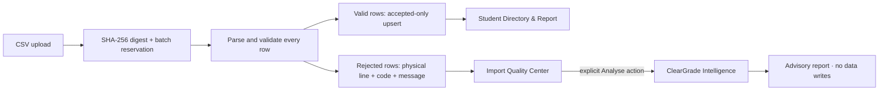

1. The administrator uploads one CSV through `/import`. The backend computes SHA-256 from the original bytes and reserves the batch before parsing.
2. The CSV adapter normalises headers and maps structural shape; `CsvRowValidator` applies domain rules and collects **every** error occurrence on a row.
3. In one atomic transaction, accepted rows are upserted, row errors are stored, counts are written and the batch becomes `COMPLETED`. A fatal file error rolls back data and marks the batch `FAILED` separately.
4. The Import Quality Center shows rows read, new/changed/unchanged, rejected rows and problem occurrences; valid students appear in the searchable directory and individual report.
5. Only on an explicit action does ClearGrade Intelligence interpret the **aggregate** counters. Import itself never calls an AI provider.

<a id="architecture"></a>

## 🏗️ Architecture

A modular monolith: one Spring Boot deployable with enforced inward dependencies (`adapters → application → domain`). AI providers are isolated behind an output port; no AI SDK, framework or agent runtime is added.

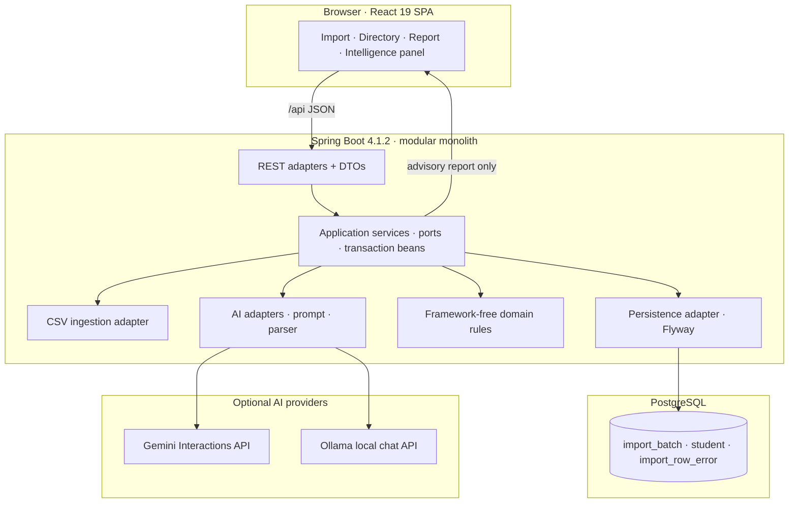

| Component | Responsibility |
|---|---|
| React SPA | Four screens, typed API client, server state via TanStack Query, responsive layout |
| REST adapters | Multipart upload, DTO mapping, status codes, paginated reads, safe error envelope |
| CSV adapter | BOM/line-ending handling, header mapping, quoted fields, physical-line map; no business rules |
| Application layer | Use-case orchestration, ports, validation, routing, cache, transaction boundaries |
| Domain | Value objects, five-code error vocabulary, `BigDecimal` grading; no framework imports |
| Persistence | JPA entities/repositories/mappers, Flyway V1 schema, exact digest and upsert SQL |
| AI adapters | Gemini/Ollama wire code, prompt construction, strict response parsing — provider code never leaks inward |

<a id="engineering-highlights"></a>

## 🧠 Engineering Highlights

| Area | What is implemented |
|---|---|
| ⚡ Ingestion | Commons CSV 1.14.1, BOM stripped before decoding, LF/CRLF/lone CR, quoted commas and newlines, independent `PhysicalLineMap` from `getCharacterPosition()` |
| 🧾 Validation | Five exact codes, all problems per row collected, first occurrence reserves an ID even when rejected, one persisted occurrence per problem |
| ♻️ Idempotency | SHA-256 reservation, partial unique index on active digests, exact `23505` recovery outside the failed transaction, accepted-only upsert |
| 🧱 Transactions | T1–T4 as separate proxied `REQUIRES_NEW` beans; T3 is the single all-or-nothing commit; T4 records `FAILED` independently |
| 🎓 Grading | Exact `BigDecimal` calculation, `NUMERIC` columns without scale, derived on read, display rounded HALF_UP to one decimal — stored marks never rounded |
| 🤖 Intelligence | Sequential Gemini → Ollama → rules, engine attribution, 600 s / 64-entry TTL/LRU cache, single-flight coalescing, optional cooldown |
| 🔐 Privacy | One purpose-built aggregate DTO plus Java-approved findings per provider, PII sentinel tests on real outbound bodies, providers limited to explanation wording |
| 📦 Delivery | Native PostgreSQL 18 vs. container/Testcontainers PostgreSQL 16, non-root images, loopback-only ports, CI on `main` |

<a id="technical-deep-dives"></a>

## 🔬 Technical Deep Dives

<details>
<summary><b>🧾 CSV ingestion and validation — how a messy file becomes explainable rows</b></summary>

`CommonsCsvFileParser` (in `adapters.in.csv`) implements an application-owned port and returns only application-owned types. It uses an explicit `CSVFormat` with comment markers disabled, strips a UTF-8 BOM **before** building both the line map and the parser, and preserves LF, CRLF, lone CR, quoted commas, escaped quotes and embedded newlines. Header mapping is order-insensitive, case-insensitive and whitespace-tolerant; extra columns are ignored, while field counts are checked against the **actual header width**. Blank and all-empty physical lines are counted for line accuracy but excluded from counters.

Each row's reported line is the **physical starting line** derived from `CSVRecord.getCharacterPosition()` plus an independent `PhysicalLineMap` (header = 1). A counting `Reader` was rejected without parser buffering evidence; an approved parser spike tested an embedded newline, blank lines, a malformed row afterwards and a later valid row. Wrong field counts are recoverable occurrences; unterminated quotes, empty files, header-only files and duplicate headers are safe file-level failures with a retained cause but no raw CSV or PII in messages or logs.

`CsvRowValidator` reuses domain value objects and emits all applicable errors. The five codes are `MISSING_REQUIRED`, `INVALID_FORMAT`, `OUT_OF_RANGE`, `DUPLICATE_ID` and `WRONG_FIELD_COUNT`. The first case-insensitive occurrence of a student ID reserves it even if that row is rejected for another reason; later occurrences receive `DUPLICATE_ID`. `ImportApplicationService` computes SHA-256 from the original bytes and owns the full sequence. Accepted rows only are upserted by normalized ID into PostgreSQL, preserving `first_seen_batch_id`, advancing `last_updated_batch_id` on a real change, and distinguishing new / changed / unchanged.

</details>

<details>
<summary><b>🤖 ClearGrade Intelligence — Gemini → Ollama → deterministic rule engine</b></summary>

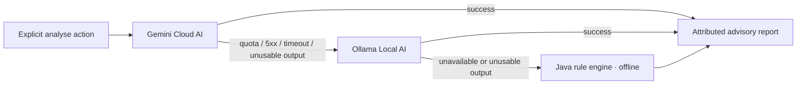

**Gemini primary.** One stateless, non-streaming `POST /v1beta/interactions` (Interactions REST API) with `x-goog-api-key`, `Api-Revision: 2026-05-20`, top-level `store: false`, no `previous_interaction_id`, low thinking and a bounded output token budget. Default model `gemini-3.8-flash` (`GEMINI_MODEL`), 10 s connect and configurable 60 s read timeout. There is **no automatic Gemini POST retry**.

**Ollama local fallback.** Uses the native `/api/tags` endpoint to confirm the configured model is actually installed and reachable — a URL alone never counts as availability — then `/api/chat` with `stream: false` and a JSON-schema `format`. The optional model is `llama3.2:1b`; ClearGrade never downloads a model at startup or during image builds.

**Routing and attribution.** Quota responses, temporary 5xx, timeouts, connection failures and unusable output fall through to Ollama, then to the offline Java rule engine. Authentication/configuration failures (`401/403`) are a controlled `503 AI_CONFIGURATION_ERROR` with **no fallback**; a quota response is never treated as an auth error. Providers are attempted strictly sequentially, never concurrently. Every report names the engine that produced it, a safe `fallbackReason`, and honest token telemetry (`Usage unavailable` when the provider supplies none).

**Java-owned findings.** `DeterministicInsightService.assess()` is the authoritative quality policy: Java selects the findings, severity, evidence metric and value, explanation baseline, summary, overall assessment and recommended actions, and produces the same report offline when no provider is available. Providers receive the approved findings plus aggregate context and return only a `findingId` and an `explanation`. They cannot add, remove or re-severitise a finding, change its evidence, or supply recommendations. An explanation must reuse the canonical evidence value and the measured row denominator; anything else is rejected.

**Cost control.** Analysis runs only on the explicit CTA; import never invokes a provider. A bounded in-memory TTL/LRU cache (600 s, 64 entries by default) is keyed by batch, context fingerprint and engine version. Concurrent same-context requests are coalesced into one provider call via an in-flight future map; `refresh=true` bypasses the read cache but still shares the in-flight call. An optional per-batch cooldown defaults to `0`. No insight table or migration exists, and the cache disappears on restart.

**Verification status.** Mock-provider tests validate the Gemini Interactions contract, routing, privacy-safe payloads and rejection of invalid output. Local Ollama was exercised against synthetic demonstration data, but the most recent browser run accepted malformed explanation wording; stricter explanation checks now have focused regression coverage, and a verified end-to-end valid local-Ollama report after that fix has **not** been confirmed. Live Gemini cloud generation is **unverified**: a real-key browser attempt received an upstream HTTP 5xx and fell through to Ollama. No successful live Gemini result is claimed.

</details>

<details>
<summary><b>🔒 Privacy contract and strict response validation</b></summary>

Every provider receives the same purpose-built payload: rows read, imported/rejected/new/changed/unchanged counts, error occurrences, counts for the five permitted codes, backend-calculated ratios, canonical evidence values, a static schema column list and the Java-approved findings (identifier, title, severity, evidence metric/value and baseline explanation). **Never sent:** student names, IDs, emails, dates of birth, marks, grades, raw CSV or row messages, physical line numbers, uploaded filenames, entities or full API responses. Tests capture the real outbound bodies for both providers and assert that sensitive sentinels cannot occur.

A provider response is deliberately narrow: one `findings` array whose entries contain exactly `findingId` and `explanation`. Java owns severity, title, evidence metric and value, summary, overall assessment, limitations and every recommendation; a provider-supplied recommendation or a changed severity/evidence value is not accepted. Structural validation enforces exact keys, text bounds and blocked markers, and every approved finding must appear exactly once — unknown, duplicate or missing identifiers are rejected. Explanations must be plain text that includes the canonical evidence value, keeps the measured row denominator, and avoids invented baselines, percentages, filler or contradictory claims. Structural or semantic failures are treated as provider failures and the existing fallback chain continues to the next provider and then to the offline rule engine; raw provider text is never returned as a finding. The API and UI keep measured facts, Java-authored advice and explanation wording visibly separate. Reports are advisory only: no provider has a write path.

`GET /api/ai/status` exposes only safe availability flags, model names, routing state and reason codes — never a key, endpoint or provider body. `store=false` avoids stateful reuse but does not eliminate provider processing or retention terms; free and paid Gemini tiers differ, so current provider terms should be reviewed before enabling with real data.

</details>

<details>
<summary><b>🧱 Transaction boundaries, idempotency and safe retries</b></summary>

| Step | Independent commit | Purpose |
|---|---|---|
| T1 | `RECEIVED` | Reserve the SHA-256 digest before parsing |
| T2 | `PROCESSING` | Explicitly persist the transition — never inferred |
| T3 | upserts + row errors + counts + `COMPLETED` | One atomic all-or-nothing data commit |
| T4 | `FAILED` | After a T3 rollback, durably record the failure |

Each step uses a distinct proxied `REQUIRES_NEW` bean (`BatchReservationTx`, `BatchProcessingTransitionTx`, `BatchFinalisationTx`, `BatchFailureTx`) plus a fresh-transaction digest lookup, so no self-invocation silently runs work in the caller's transaction. Final counts are constrained by the database to `COMPLETED` batches only; a row-level error never fails a batch.

The partial unique index `ux_import_batch_active_sha256` covers `RECEIVED`, `PROCESSING` and `COMPLETED` batches. On the exact `23505` violation of that index, the digest is re-read **outside the failed transaction** and mapped to the documented outcomes: identical completed → `200` existing summary with no new batch; active → `409 BATCH_PROCESSING` with a batch id; failed → new batch allowed. Two simultaneous identical uploads therefore cannot both import. A failed processing transition triggers T4 with the original exception preserved and any T4 failure attached as suppressed.

</details>

<details>
<summary><b>🎓 Deterministic grading and exact marks</b></summary>

`GradingPolicy` is framework-free Java. It divides the exact `BigDecimal` total by five, then derives grade and pass from that exact value: A ≥ 80, B ≥ 70, C ≥ 60, D ≥ 50, F < 50; PASS when the overall percentage is ≥ 50. There is **no individual-subject passing threshold**. Only the display percentage is rounded (HALF_UP, one decimal); submitted marks are stored in unconstrained PostgreSQL `NUMERIC` columns with an inclusive 0–100 check and are never silently rounded.

Totals, percentages, grades and PASS/FAIL are computed on read, not stored, and AI cannot generate or change them. An injected `Clock` drives age validation (5–25 inclusive, including the documented 29 February rule), keeping tests reproducible without host-date dependence.

</details>

<a id="screenshots"></a>

## 📸 Screenshots

These are captures of the running application using deterministic synthetic demonstration data — no real student records.

<table width="100%" cellspacing="0" cellpadding="0" style="border-collapse: collapse;">
<tr>
<td width="50%" valign="top" style="border: 1px solid #d0d7de; padding: 12px; text-align: center;"><a href="docs/screenshots/import-home-page.png">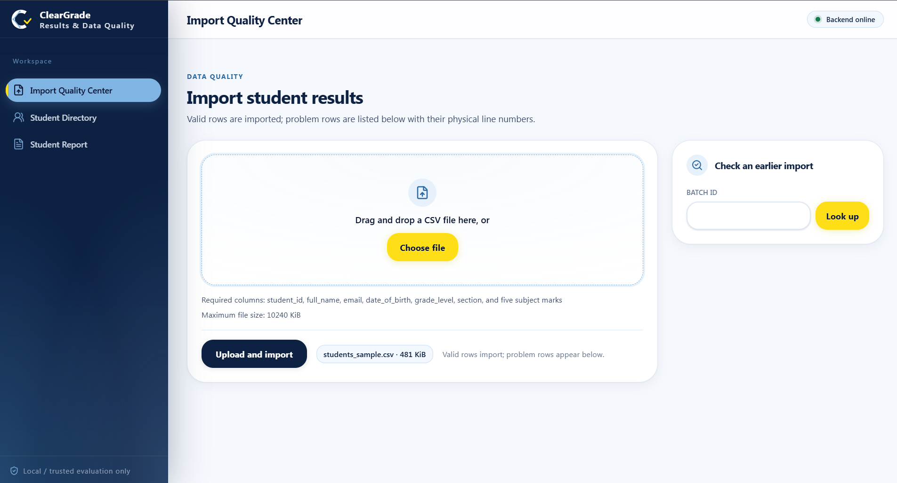</a><br/><sub><b>Import Quality Center</b> — Upload student results and start validation.</sub></td>
<td width="50%" valign="top" style="border: 1px solid #d0d7de; padding: 12px; text-align: center;"><a href="docs/screenshots/import-summary.png">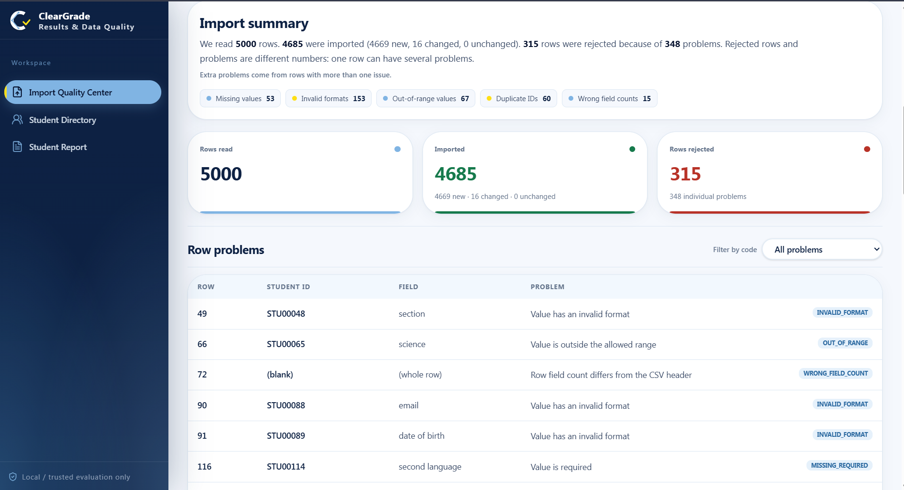</a><br/><sub><b>Import Summary</b> — Review row counts, error totals and quality metric cards.</sub></td>
</tr>
<tr>
<td width="50%" valign="top" style="border: 1px solid #d0d7de; padding: 12px; text-align: center;"><a href="docs/screenshots/row-problems.png">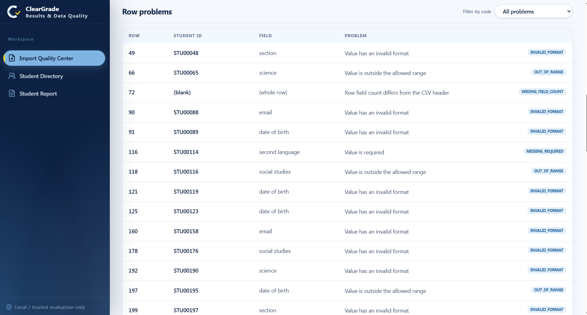</a><br/><sub><b>Row Problems</b> — Inspect rejected rows by physical line, field and error code.</sub></td>
<td width="50%" valign="top" style="border: 1px solid #d0d7de; padding: 12px; text-align: center;"><a href="docs/screenshots/intelligence-report.png">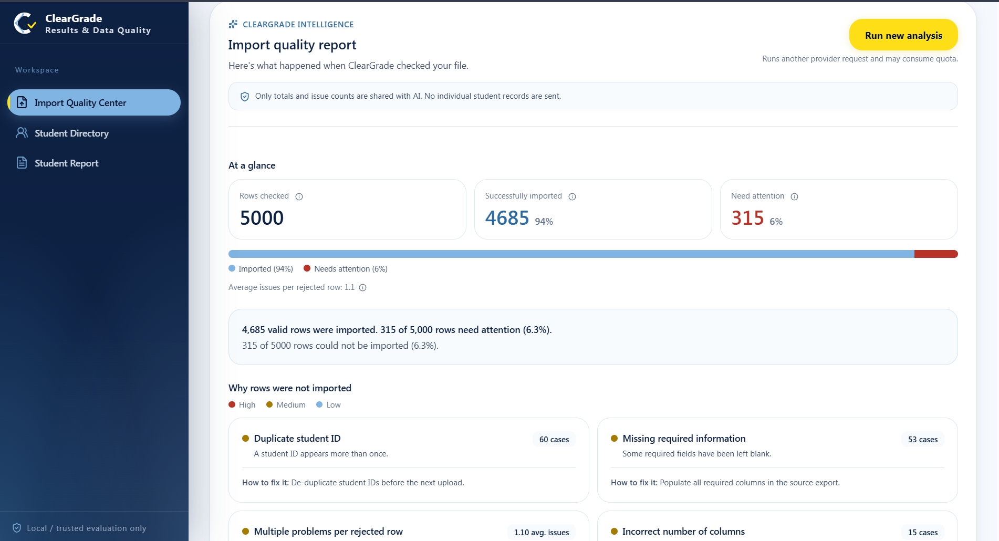</a><br/><sub><b>Intelligence Report</b> — Explore the aggregate quality report and at-a-glance metrics.</sub></td>
</tr>
<tr>
<td width="50%" valign="top" style="border: 1px solid #d0d7de; padding: 12px; text-align: center;"><a href="docs/screenshots/intelligence-outcome.png">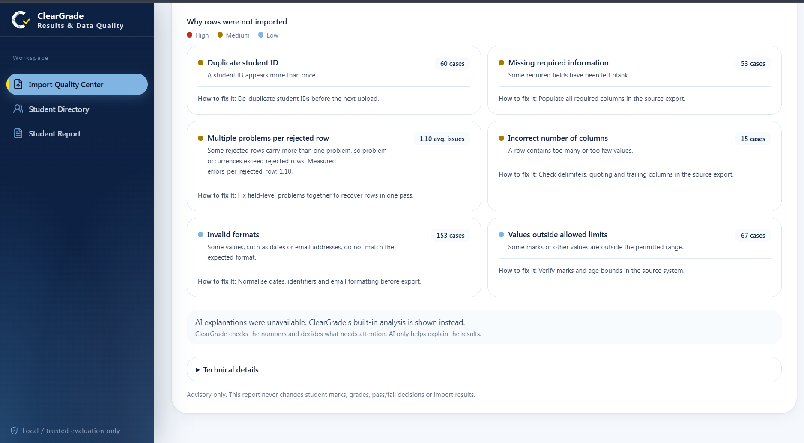</a><br/><sub><b>Intelligence Outcome</b> — Understand why rows failed and how to fix each issue.</sub></td>
<td width="50%" valign="top" style="border: 1px solid #d0d7de; padding: 12px; text-align: center;"><a href="docs/screenshots/student-directory.png">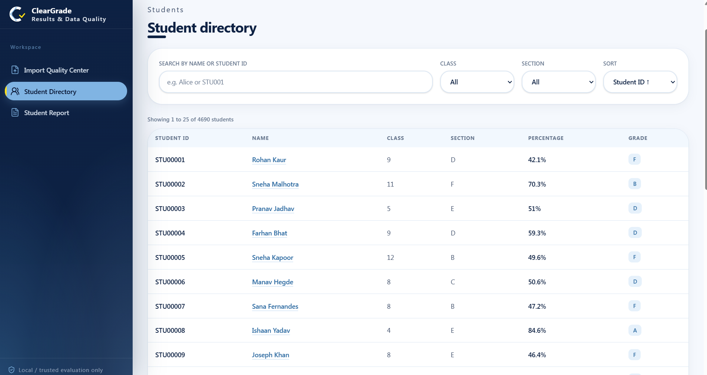</a><br/><sub><b>Student Directory</b> — Search, filter, sort and page through student records.</sub></td>
</tr>
<tr>
<td width="50%" valign="top" style="border: 1px solid #d0d7de; padding: 12px; text-align: center;"><a href="docs/screenshots/student-report.png">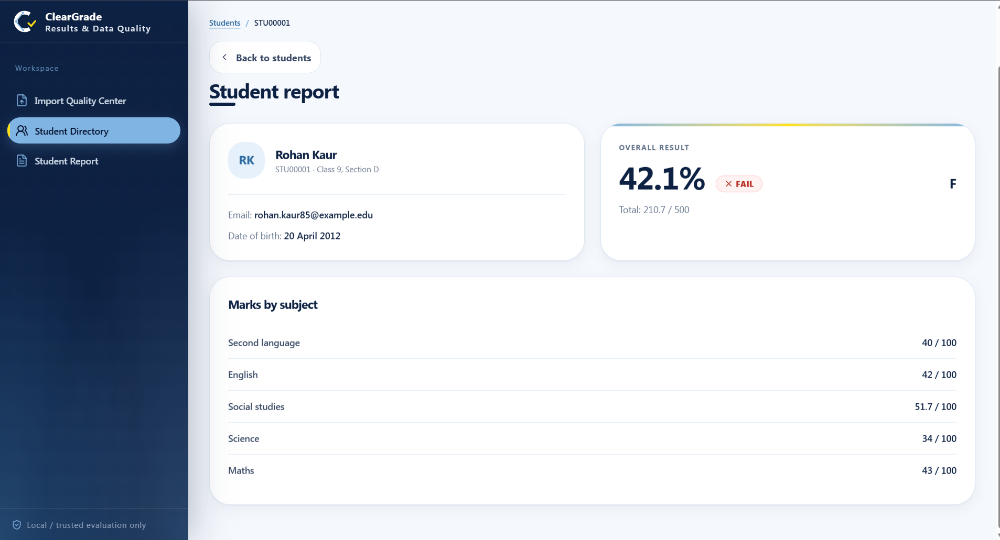</a><br/><sub><b>Student Report Finder</b> — Search by student name or ID to open a full report.</sub></td>
<td width="50%" valign="top" style="border: 1px solid #d0d7de; padding: 12px; text-align: center;"><a href="docs/screenshots/individual-report.png">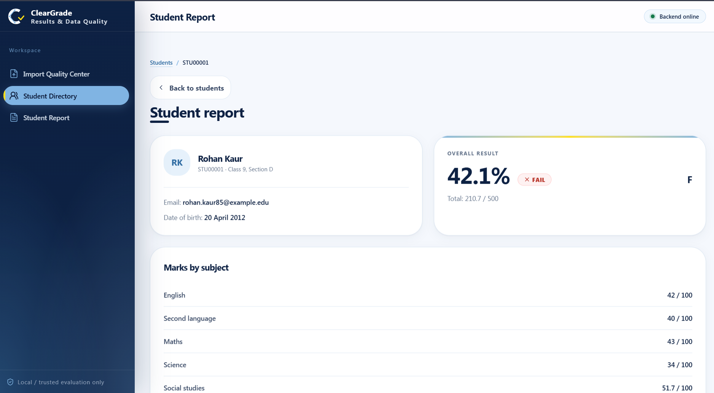</a><br/><sub><b>Individual Report</b> — View one student's marks, result and grade.</sub></td>
</tr>
</table>

<a id="api-reference"></a>

## 🔌 API Reference

All application endpoints live under `/api`. Management is a separate path: only `GET /actuator/health` is exposed, with `show-details: never`.

| Method | Endpoint | Purpose |
|---|---|---|
| `POST` | `/api/imports` | Upload CSV (multipart field `file`); `201` new or `200` deduplicated |
| `GET` | `/api/imports/{id}` | Batch summary |
| `GET` | `/api/imports/{id}/errors` | Paged row problems (`page`, `size`, `code`) |
| `GET` | `/api/students` | Paged directory (`query`, `grade`, `section`, `sort`) |
| `GET` | `/api/students/{studentId}` | Student report with derived grading |
| `GET` | `/api/ai/status` | Safe provider/routing snapshot, no inference |
| `POST` | `/api/imports/{id}/insights` | Explicit aggregate analysis, no request body |

Reads return `200`; the common failure codes are summarised below.

```powershell
# Upload a CSV
curl.exe -F "file=@students.csv" http://localhost:8080/api/imports

# Explicit analysis (only after the batch is COMPLETED)
curl.exe -X POST http://localhost:8080/api/imports/12/insights

# Check provider routing without spending quota
curl.exe http://localhost:8080/api/ai/status
```

Upload outcomes are summarized in one response shape; `imported = newCount + changedCount + unchangedCount`, while `rejected` counts rows and `errorCount` counts problem occurrences.

```json
{
  "id": 12,
  "status": "COMPLETED",
  "rowsRead": 1000,
  "imported": 952,
  "newCount": 940, "changedCount": 8, "unchangedCount": 4,
  "rejected": 48,
  "errorCount": 61,
  "deduplicated": false
}
```

Common error behaviour: `MISSING_REQUIRED_COLUMNS` / `INVALID_ENCODING` / `EMPTY_FILE` / `MALFORMED_CSV` → `400`; `INVALID_FILE_TYPE` → `415`; `FILE_TOO_LARGE` → `413`; `BATCH_PROCESSING` → `409` with `batchId`; `BATCH_NOT_FOUND` / `STUDENT_NOT_FOUND` → `404`; `BATCH_NOT_COMPLETED` → `409`; `ANALYSIS_COOLDOWN` → `429`; `AI_CONFIGURATION_ERROR` / `ANALYSIS_UNAVAILABLE` → `503`; `INTERNAL_ERROR` → `500` with a correlation id. Row-level problems are **never** HTTP errors: the batch completes successfully with non-zero rejection counters. Full shapes and query parameters are in [docs/API_CONTRACT.md](docs/API_CONTRACT.md).

<a id="tech-stack"></a>

## 🛠️ Tech Stack

| Layer | Technologies |
|---|---|
| Backend | Java 21 · Spring Boot 4.1.2 · Spring Web / Data JPA / Validation / Actuator · Flyway 12 · Apache Commons CSV 1.14.1 · JUnit 5 · Mockito · Maven wrapper 3.9.14 |
| Frontend | React 19.3 · TypeScript 5.9 · Vite 7 · Tailwind CSS 4 · React Router 7 · TanStack Query 5 · Lucide React · Vitest + Testing Library |
| Database | PostgreSQL 18 native (Windows service) · PostgreSQL 16-alpine in Docker Compose and Testcontainers |
| AI integration | Gemini Interactions REST (`gemini-3.8-flash`, configurable) · Ollama native chat (`llama3.2:1b`, optional) · Java rule engine · plain `HttpClient`, no AI SDK |
| Delivery | Multi-stage non-root backend/frontend Docker images · Compose with healthchecks and named volume · GitHub Actions (`main`) · PowerShell/Unix start, test and seed scripts |

<a id="getting-started-windows-native"></a>

## 🚀 Getting Started (Windows native development)

### Prerequisites

- JDK 21 (set `JAVA_HOME=C:\Program Files\Java\jdk-21.0.10` if your default `java` is 17)
- Node.js 22+ and npm; Git
- Native PostgreSQL 18 service `postgresql-x64-18` running (database `cleargrade`, role `cleargrade_local`)
- Docker Desktop with Compose v2 only for the container path (see [Docker Quick Start](#docker-quick-start))

### 1 · Clone and configure secrets

```powershell
git clone https://github.com/soubhagya-behera/cleargrade.git
cd cleargrade
copy .env.example .env
# edit .env: set CLEARGRADE_LOCAL_DB_PASSWORD (required); GEMINI_API_KEY is optional
```

The root `.env` is git-ignored. Non-secret defaults — datasource URL, port `8080`, model names, cache limits — live in `backend/src/main/resources/application.properties`. The Spring app imports the root `.env` automatically when run from `backend/`.

### 2 · Start backend and frontend

```powershell
# Terminal 1 — backend (binds 127.0.0.1:8080)
cd backend
.\mvnw.cmd spring-boot:run

# Terminal 2 — frontend (http://localhost:5173)
cd frontend
npm ci
npm run dev
```

Health: <http://localhost:8080/actuator/health>. API base: <http://localhost:8080/api>. Optional local Ollama: start `ollama.exe serve`, confirm `/api/tags` lists `llama3.2:1b`, then use the **Analyse import** CTA.

### Environment variables (only the private or optional ones)

| Variable | Required | Purpose |
|---|---|---|
| `CLEARGRADE_LOCAL_DB_PASSWORD` | Native | Password for the least-privilege `cleargrade_local` database role |
| `GEMINI_API_KEY` | Optional | Enables Gemini as primary provider; never logged, returned or sent to the browser |
| `GEMINI_MODEL` | Optional | Overrides the `gemini-3.8-flash` default |
| `CLEARGRADE_AI_ENABLED` | Optional | `false` disables both AI providers; the rule engine still works |
| `OLLAMA_BASE_URL` / `OLLAMA_MODEL` | Optional | Host Ollama endpoint/model; native defaults are `127.0.0.1:11434` / `llama3.2:1b` |
| `CLEARGRADE_AI_COOLDOWN_SECONDS` | Optional | Per-batch analysis cooldown; default `0` |
| `POSTGRES_PASSWORD` / `POSTGRES_PORT` | Docker only | Compose database password and configurable loopback host port |
| `CLEARGRADE_UPLOAD_MAX_FILE_SIZE` | Optional | Upload cap in bytes; default `10485760` (10 MiB) |

### Alternative: Docker Compose workflow

If you prefer containers, stop the native backend/frontend first; the [Docker Quick Start](#docker-quick-start) above is the quicker evaluator route:

```powershell
docker compose up -d --build
# frontend http://localhost:3000 · health http://localhost:8080/actuator/health
docker compose down   # stop containers; keep the PostgreSQL volume
```

`.\scripts\start.ps1` automates these steps, including first-run `.env` setup. Compose uses its **own** PostgreSQL 16 container, named volume and host port from `.env`; it does not touch the native database. All published ports bind to `127.0.0.1`. **`docker compose down -v` is destructive: it deletes the database volume and all imported data.** Full details: [LOCAL_RUN_GUIDE.md](LOCAL_RUN_GUIDE.md).

<a id="performance-and-constraints"></a>

## ⚡ Performance and Constraints

| Constraint | Behaviour |
|---|---|
| Upload size | 10 MiB default, configurable; `413 FILE_TOO_LARGE` before parsing |
| Import scope | Single transaction for all rows — appropriate at ~5,000 rows; no chunked progress state |
| Pagination | Students default 25 / max 100; row errors default 50 / max 100; no unbounded collections |
| AI cache | 600 s TTL, 64 entries, in-memory only; lost on backend restart, no insight table |
| Request behaviour | Explicit trigger only; single-flight coalescing; optional cooldown; no automatic Gemini POST retry |
| Model limits | Low thinking, bounded output tokens; the 1 B Ollama model has produced malformed explanation wording in testing, which strict validation rejects before the fallback chain continues |
| Database | Native PostgreSQL 18 vs. container/Testcontainers PostgreSQL 16; Flyway V1 owns schema, Hibernate validates only |
| Application scope | Current-result snapshot only; no term/year, no batch-list endpoint; no authentication |

> [!IMPORTANT]
> Gemini-generated interpretation is advisory, not independently verified fact. AI receives aggregate counters only and cannot change data. Keep the application on loopback/trusted networks.

<a id="testing-and-quality"></a>

## 🧪 Testing and Quality

- **Backend:** **286 tests passed, 0 failures, 0 errors, 1 skipped** across 40 test classes — the skipped test is the opt-in live Gemini smoke test, which requires `CLEARGRADE_LIVE_GEMINI_SMOKE=true` **and** a user-supplied key. These counts match the current Surefire reports.
- **Frontend:** **45 tests passed, 0 failures** (Vitest + Testing Library), plus TypeScript check and Vite production build.
- **Integration coverage:** Testcontainers PostgreSQL 16 backs migration, persistence, T1–T4 transaction, REST API and benchmark tests. Mock HTTP servers capture real Gemini/Ollama request bytes for protocol and PII-sentinel assertions.
- **Genuine benchmark evidence:** the current `CsvImportBenchmarkTest` Surefire report records **163 ms** for the small fixture and **5,407 ms** for the 5,000-row fixture, with exact counts **25 / 16 / 9** and **5,000 / 4,685 / 315 rejected / 348 occurrences** (fixed clock `2026-11-19`, JDK 21.0.10, `postgres:16-alpine`). These are informational observations, not acceptance thresholds.
- **Verification status:** verified by automated tests are the Gemini/Ollama mock-provider contract, routing, sanitized failure telemetry, privacy-safe aggregate payloads, strict explanation validation and the offline `RULE_BASED` deterministic fallback. Historical browser runs used synthetic data; a verified valid end-to-end local Ollama report after the parser hardening is **not** claimed. A real-key browser attempt reached Gemini and received an upstream HTTP 5xx, so the chain fell through to Ollama — evidence of fallback only, **not** successful live Gemini generation. No live AI report is claimed as verified; the CI badge reports `main` only and branch verification is recorded here. No OWASP dependency-check scan is configured in CI, so a backend dependency vulnerability scan has not been verified.

<a id="security-and-privacy"></a>

## 🔐 Security and Privacy

- **Local/trusted only:** no authentication by design. Do not publicly expose the application without an authentication layer and network controls.
- **Narrow surface:** backend binds to `127.0.0.1`; Compose publishes loopback ports; only `/actuator/health` is exposed; DTOs never leak JPA entities; page size and sort fields are allowlisted.
- **Secrets:** real values live only in the git-ignored root `.env`; the key is never placed in Vite variables, Docker build arguments, images, responses or logs.
- **PII handling:** raw CSV records, emails, dates of birth and row-message bodies are never logged; row problems carry administrator-friendly text only.
- **AI boundary:** aggregate-only context, no write path, advisory-only output. See [docs/SECURITY.md](docs/SECURITY.md) and [docs/AI_INTELLIGENCE.md](docs/AI_INTELLIGENCE.md).

<a id="project-structure"></a>

## 🗂️ Project Structure

```text
cleargrade/
├── backend/
│   ├── pom.xml · Dockerfile · config/application-local.example.properties
│   └── src/
│       ├── main/java/dev/cleargrade/
│       │   ├── domain/          # value objects, grading, error vocabulary (pure Java)
│       │   ├── application/     # services, ports in/out, T1–T4 transaction beans
│       │   └── adapters/        # in/web, in/csv, out/persistence, out/ai
│       ├── main/resources/      # application.properties · db/migration/V1__create_core_schema.sql
│       └── test/                # 40 test classes
├── frontend/
│   ├── package.json · vite.config.ts · Dockerfile · nginx.conf
│   └── src/                     # api, components, features, styles, types, tests
├── docs/
│   ├── ARCHITECTURE.md · API_CONTRACT.md · AI_INTELLIGENCE.md
│   ├── DATA_MODEL.md · SECURITY.md · TEST_STRATEGY.md · UX_SPEC.md
│   └── screenshots/             # 8 synthetic-data captures
├── scripts/                     # start, test, seed + PII-free CSV fixtures
├── .github/workflows/ci.yml
├── docker-compose.yml · .env.example
├── DECISIONS.md · DEVELOPMENT.md · LOCAL_RUN_GUIDE.md · PROJECT_STATUS.md
└── README.md
```

<a id="roadmap-and-limitations"></a>

## 🗺️ Roadmap and Limitations

Implemented scope is complete; the following are **deferred or unverified**, not shipped features:

- Authentication and multi-tenancy before any non-local deployment.
- A batch-history/list endpoint backed by the existing `import_batch` table.
- A persistent, privacy-safe per-batch insight cache that survives restarts.
- Deferred UI extras: error-CSV download, per-subject mark bars and printable report.
- A recovery sweep for stale `RECEIVED` batches after an interrupted startup.
- Live Gemini verification with a user-supplied key; browser E2E automation in CI.
- The exact pragmatic email grammar boundary remains an explicit owner decision.

Current-result snapshot only — no academic history is invented. The AI cache is in-memory, and live cloud generation has not been verified in this environment.

---

<div align="center">

### 👨‍💻 Built by Soubhagya Kumar Behera

Java Full Stack Developer · Spring Boot · React · Data Quality Engineering

[](https://github.com/soubhagya-behera)
[](https://www.linkedin.com/in/soubhagyakumar-java)
[](https://soubhagya-dev.vercel.app)

⭐ If ClearGrade helped you understand CSV ingestion, idempotency or advisory AI, consider starring the repository.

License: not specified — no `LICENSE` file is present in this repository.

</div>
