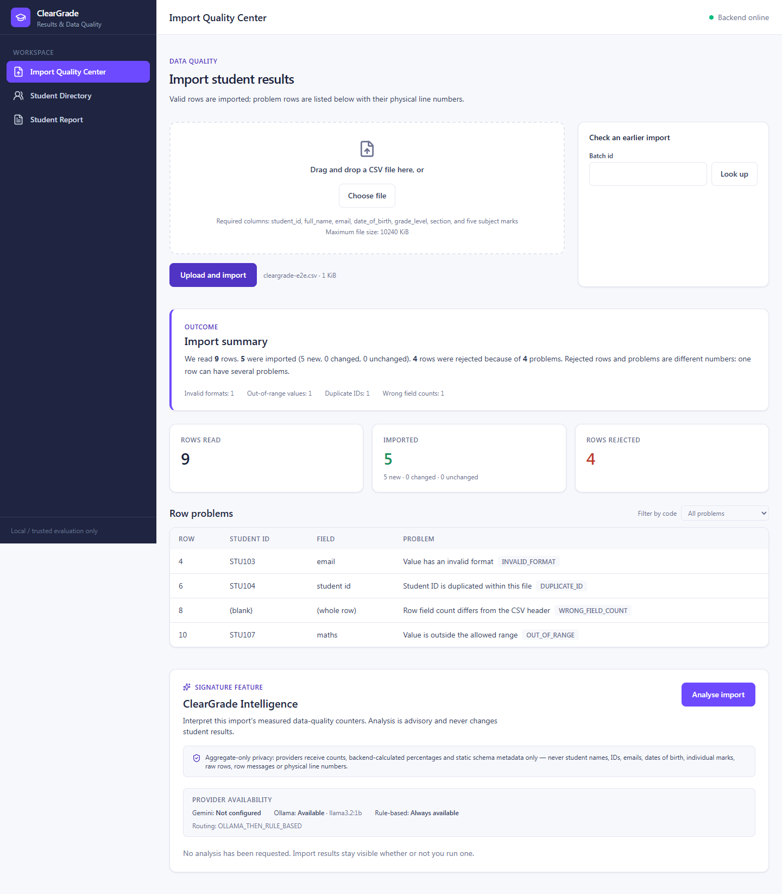
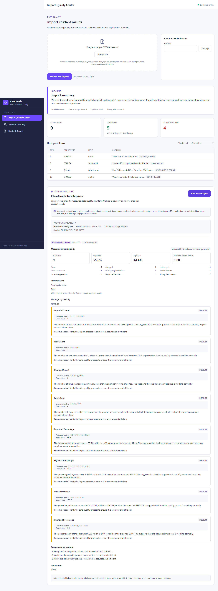
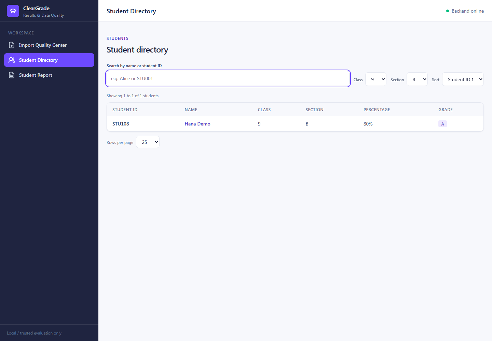
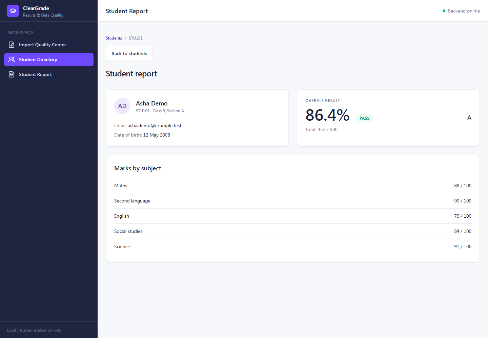
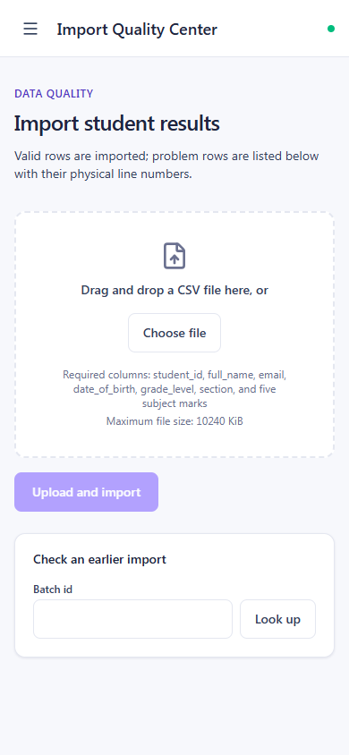
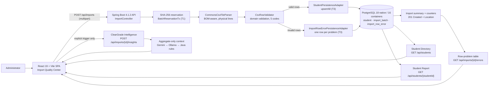
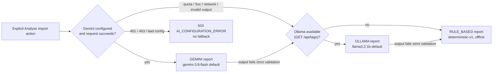
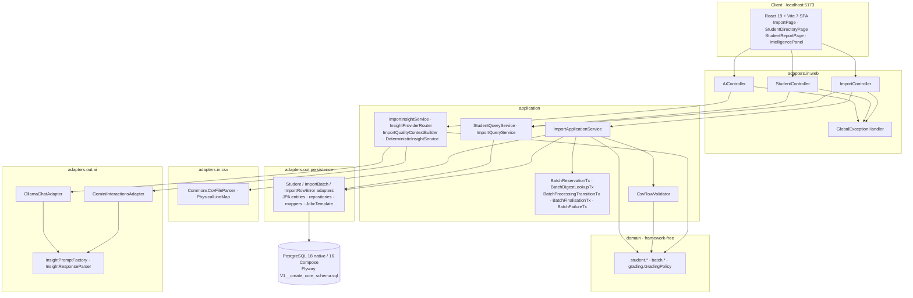
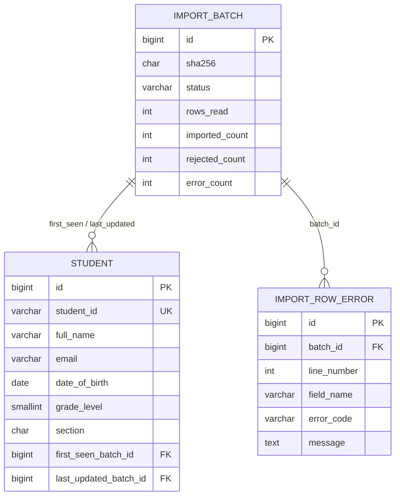

<div align="center">

# ClearGrade

### Student Results & Data Quality Intelligence Platform

**Turn messy student-result spreadsheets into validated student records, explainable import reports and actionable data-quality intelligence.**

[](https://openjdk.org/projects/jdk/21/)
[](https://spring.io/projects/spring-boot)
[](https://react.dev/)
[](https://www.typescriptlang.org/)
[](https://www.postgresql.org/)

[](https://github.com/soubhagya-behera/cleargrade-student-results/actions/workflows/ci.yml)


*The CI badge tracks the repository's `main` workflow only; it does not report CI for this feature branch. Verification evidence for this branch is reported separately in [Testing](#testing-and-quality). PostgreSQL 18 is used for native Windows development; PostgreSQL 16 is used by Docker Compose and Testcontainers.*

[Overview](#what-is-cleargrade) · [Highlights](#product-highlights) · [Tour](#visual-tour) · [Workflow](#how-cleargrade-works) · [CSV engine](#csv-ingestion-and-validation) · [Grading](#grading-system) · [Intelligence](#cleargrade-intelligence) · [Architecture](#architecture) · [Data](#database-and-data-integrity) · [API](#api-reference) · [Stack](#technology-stack) · [Run locally](#getting-started-windows-native-development) · [Docker](#optional-docker-workflow) · [Testing](#testing-and-quality) · [Security](#security-and-privacy) · [Decisions](#engineering-decisions-and-limitations) · [Roadmap](#roadmap)

**[Run locally →](#getting-started-windows-native-development)**

<table>
<tr>
<td align="center"><strong>Terminal 1 · backend</strong><br/><code>cd backend</code><br/><code>mvn spring-boot:run</code></td>
<td align="center"><strong>Terminal 2 · frontend</strong><br/><code>cd frontend</code><br/><code>npm run dev</code></td>
</tr>
</table>

</div>

---

## What is ClearGrade?

School administrators routinely receive inconsistent CSV exports of student results. A single malformed cell can silently corrupt a record, and a rejected row reported only as "row failed" gives no clue how to fix the source file. ClearGrade makes the import **traceable, deterministic and explainable** — and then, optionally, interprets the measured import quality with an advisory AI copilot.

In 20 seconds: an administrator uploads one CSV; ClearGrade validates every row, imports the valid students into a searchable directory, reports each rejected row with its **physical file line, field, error code and readable message**, computes grades from fixed backend rules, and can summarise the import's data quality with privacy-safe aggregate analysis.

| Problem | ClearGrade solution |
|---|---|
| CSV exports differ in header case, order and whitespace | Header normalization with order-independent, case-insensitive column mapping; extra columns ignored |
| A bad cell can corrupt imported student records | Row-level validation; a row is rejected if **any** field fails |
| "Row 14 failed" is not enough to repair a spreadsheet | One problem record per issue with physical line, field, code and message |
| Re-uploading the same file duplicates students | SHA-256 digest reservation with `200` deduplicated replay and `409` active-batch conflict |
| Case variants of the same student ID can overwrite each other | Case-insensitive ID normalization and first-occurrence reservation |
| Grades differ between hand-maintained spreadsheets | Deterministic `GradingPolicy` derived on read — never generated by AI |
| It is hard to tell whether data quality is improving | Import counters plus an explicit, aggregate-only ClearGrade Intelligence analysis |

> **Scope note:** the source CSV has no term or year column, so ClearGrade stores a **current-result snapshot**, not academic history. There is **no authentication** — this is a local/trusted evaluation application, not a public multi-tenant service.

## Product highlights

<table>
<tr>
<td width="50%" valign="top">

**Robust CSV ingestion**

Apache Commons CSV 1.14.1 with an explicit format; quoted commas, embedded newlines and blank rows handled.

</td>
<td width="50%" valign="top">

**Header normalization**

Required columns mapped by stripped, lower-cased names; order and surrounding whitespace tolerant, extra columns ignored.

</td>
</tr>
<tr>
<td width="50%" valign="top">

**UTF-8 and line-ending support**

BOM stripping plus LF, CRLF and lone-CR handling with independent physical-line mapping.

</td>
<td width="50%" valign="top">

**Physical line numbers**

Header is line 1, data starts at line 2; every reported problem points at the real file line.

</td>
</tr>
<tr>
<td width="50%" valign="top">

**Row-level validation**

Five exact error codes, all problems collected per row, whole-row field-count errors reported separately.

</td>
<td width="50%" valign="top">

**Idempotent batches**

SHA-256 digest plus a PostgreSQL partial unique index; replay-safe, conflict-aware, retryable after failure.

</td>
</tr>
<tr>
<td width="50%" valign="top">

**PostgreSQL student upserts**

Insert-on-conflict, then row-locked comparison classifies each row as new, changed or unchanged.

</td>
<td width="50%" valign="top">

**Directory and reports**

Server-side search, grade/section filters, sorting and pagination; deterministic result reports with derived grades.

</td>
</tr>
<tr>
<td width="50%" valign="top">

**ClearGrade Intelligence**

Explicit-trigger, advisory-only interpretation of measured import counters — not a chatbot and never a write path.

</td>
<td width="50%" valign="top">

**Provider routing**

Gemini → Ollama → deterministic Java rules, with strict structured-output validation and honest engine attribution.

</td>
</tr>
<tr>
<td width="50%" valign="top">

**Privacy-safe analysis**

Providers receive aggregates only; no names, IDs, emails, dates of birth, marks, rows, messages or line numbers.

</td>
<td width="50%" valign="top">

**Cache and coalescing**

Bounded TTL/LRU cache plus single-flight request coalescing; one Gemini inference per explicit fresh analysis.

</td>
</tr>
<tr>
<td width="50%" valign="top">

**Native Windows development**

Two terminals, native PostgreSQL and pgAdmin, root `.env` imported automatically by Spring Boot.

</td>
<td width="50%" valign="top">

**Docker Compose alternative**

Three health-checked containers, loopback-only published ports and a persistent named PostgreSQL volume.

</td>
</tr>
</table>

## Visual tour

Real browser captures of the running application. All records shown are **synthetic demonstration data** (`... Demo`, `example.test`); no assignment sample CSV, confidential PDF or real student information appears in any image.

[](docs/screenshots/01-import-quality-center.png)

**Import Quality Center** — drop zone, plain-language import summary, stat cards and the physical-line problem table with error-code filter.

[](docs/screenshots/02-cleargrade-intelligence.png)

**ClearGrade Intelligence** — measured facts kept separate from engine interpretation, severity-ranked findings with exact evidence values, recommended actions and provider attribution.

[](docs/screenshots/03-student-directory.png)

**Student Directory** — debounced search, class/section filters, sortable columns, pagination and derived percentage/grade.

[](docs/screenshots/04-student-report.png)

**Student Report** — identity, overall result with PASS/FAIL and grade, and all five subject marks.

[](docs/screenshots/05-mobile-import.png)

**Responsive layout** — the same workspace collapses to a mobile navigation drawer and single-column flow.

## How ClearGrade works



**Import lifecycle.** The controller checks file type, encoding and the 10 MiB cap; `ImportApplicationService` hashes the raw bytes and runs four independently committed transactions:

```mermaid
sequenceDiagram
    autonumber
    participant FE as React client
    participant API as ImportController
    participant SVC as ImportApplicationService
    participant PG as PostgreSQL
    FE->>API: POST /api/imports (multipart "file")
    API->>SVC: importFile(bytes, filename)
    SVC->>PG: T1: reserve RECEIVED batch with SHA-256 digest
    alt digest already COMPLETED
        PG-->>SVC: existing batch
        SVC-->>API: deduplicated = true
        API-->>FE: 200 OK (no new import)
    else new or retriable digest
        SVC->>PG: T2: RECEIVED → PROCESSING
        SVC->>SVC: parse + validate (outside a transaction)
        SVC->>PG: T3: upserts + error rows + counts + COMPLETED (atomic)
        SVC-->>API: ImportResponse
        API-->>FE: 201 Created + Location
    end
    Note over SVC,PG: Any failure → T4 commits FAILED separately; no partial writes
```

**Valid rows** become `Student` aggregates and are upserted into `student`. **Invalid rows** are excluded from `student`; each of their problems is persisted as an `import_row_error` with a physical line number.

**Rejected rows vs. error occurrences.** `rejected` counts each rejected *row once*. `errorCount` counts *problem occurrences* — a single row with an invalid email and an out-of-range mark is one rejected row but two error occurrences. The schema enforces `error_count >= rejected_count`, and the UI explains the difference explicitly.

## CSV ingestion and validation

**Required columns** (all eleven, header names normalized by `strip()` + lowercase):

```text
student_id, full_name, email, date_of_birth, grade_level, section,
maths, science, english, social_studies, second_language
```

| Concern | Implemented behavior |
|---|---|
| Header matching | Case- and whitespace-insensitive, order-independent; duplicate normalized headers are a fatal error; extra columns are ignored; a missing required column is a fatal `400` |
| Encoding | Strict UTF-8 decode; a leading UTF-8 BOM is stripped |
| Line endings | LF, CRLF and lone CR; newlines inside quoted fields counted correctly by `PhysicalLineMap` |
| Quoting | Quoted commas and embedded newlines via Commons CSV; surrounding spaces are preserved |
| Blank rows | All-blank records are skipped and not counted |
| File size | 10 MiB default (`cleargrade.upload.max-file-size`), enforced by multipart settings and the controller (`413 FILE_TOO_LARGE`) |
| Dates | `yyyy-MM-dd` first, then strict `dd/MM/yyyy`; age window 5–25 in business zone `Asia/Kolkata` |
| Marks | Five marks, each numeric in `0..100`; total and percentage stay exact `BigDecimal` |
| Identity | `student_id` normalized to uppercase; duplicates detected case-insensitively; the **first occurrence reserves the ID** even if that row later fails other fields |
| Reporting | `PhysicalLineNumber`: header = 1, first data row = 2; every problem stores its line, field, code and message |

**Row error codes** (`dev.cleargrade.domain.batch.RowErrorCode`, also enforced by a database `CHECK`):

| Code | Meaning |
|---|---|
| `MISSING_REQUIRED` | A required value is absent or blank |
| `INVALID_FORMAT` | A value cannot be parsed into its expected type (date, mark, ID, name, …) |
| `OUT_OF_RANGE` | A parsed value is outside its allowed bounds (age, grade, section, mark, …) |
| `DUPLICATE_ID` | The normalized student ID was already reserved by an earlier row in this file |
| `WRONG_FIELD_COUNT` | Record width differs from the header; reported against the whole row and not field-validated |

File-level failures use a separate vocabulary — `EMPTY_FILE`, `MISSING_REQUIRED_COLUMNS`, `MALFORMED_CSV` and `INVALID_ENCODING` — and return `400` with the same error envelope. Deep implementation notes live in [ARCHITECTURE.md](docs/ARCHITECTURE.md) and [API_CONTRACT.md](docs/API_CONTRACT.md).

## Grading system

Grades are **pure backend rules** in `dev.cleargrade.domain.grading.GradingPolicy`. They are derived when a report or directory row is read and are **never persisted or AI-generated**.

| Band | Condition on exact percentage | Result |
|---|---|---|
| A | `>= 80` | PASS |
| B | `>= 70` | PASS |
| C | `>= 60` | PASS |
| D | `>= 50` | PASS |
| F | `< 50` | FAIL |

- Exact percentage = sum of the five marks / 5, using exact `BigDecimal` division.
- PASS when exact percentage `>= 50`; there is no per-subject pass threshold.
- Only **display** is rounded: `setScale(1, RoundingMode.HALF_UP)`. Grading and pass/fail always use the unrounded value.
- Maximum total is `500`; `StudentOutcome` re-validates internal consistency on every read.

## ClearGrade Intelligence

ClearGrade Intelligence is an **AI data-quality copilot**, not a general-purpose chatbot. It is triggered explicitly from a completed import, interprets only counters the backend already measured, and is **advisory only**: it cannot change marks, grades, pass/fail decisions, accepted or rejected rows, students or import counters.

### Provider routing



| Priority | Engine | Label | Selected when |
|---|---|---|---|
| 1 | Gemini Interactions REST API | `GEMINI` | Key configured and a request succeeds |
| 2 | Ollama local chat API | `OLLAMA` | Gemini absent or fallback-class failure, and `/api/tags` confirms the model |
| 3 | Java rule engine | `RULE_BASED` | Both AI providers absent/failed; network-free, reproducible, explicitly not AI-generated |

### Privacy boundary

Every provider receives the **same purpose-built aggregate DTO** built by `ImportQualityContextBuilder`: row/import/reject/new/changed/unchanged/error counts, the five error-code counts, backend-calculated percentages and ratios, canonical evidence values, and static schema-column metadata.

| Never sent to any provider | Reason |
|---|---|
| Student names, IDs, emails, dates of birth, marks or grades | Direct identifiers / personal data |
| Raw CSV rows, row messages or physical line numbers | Row-level content that can identify a person |
| Uploaded filenames or full import responses | Unnecessary context |
| API keys or credentials | Keys stay server-side and never reach the frontend |

`PrivacyContractTest` and provider HTTP tests assert that sensitive sentinels cannot appear in captured request bodies. The strict `InsightResponseParser` rejects unknown fields, over-long text, unsupported severities/metrics and blocked markers; every `evidenceValue` is replaced with the backend-computed value, so a model cannot alter measured counters.

### Findings, evidence and safety

- Findings carry a severity of `INFO`, `LOW`, `MEDIUM` or `HIGH`, one allowlisted evidence metric, its **exact** backend value, an explanation and a recommended remediation action.
- Measured facts, engine interpretation and advisory guidance are separate fields in both the API and the UI.
- `advisoryOnly=true` on every response; the UI repeats the disclaimer. `store:false`, `stream:false`, `thinking_level=low`, `max_output_tokens=2048`, no history and no tools; **one Gemini inference per explicit fresh analysis**, with no automatic POST retries.
- A bounded TTL/LRU cache (600 s, 64 entries) reuses a report for the same batch/context/engine, and single-flight coalescing makes simultaneous requests share one generation — including explicit refresh. An optional per-batch cooldown returns `429 ANALYSIS_COOLDOWN`.
- `GET /api/ai/status` reports configuration and reachability **separately** and never claims inference works: `geminiConfigured` only means a key is present, `/api/tags` drives Ollama availability, and status never spends quota.
- Safe usage telemetry (input/output/thinking/total tokens, model, interaction status, duration) is shown when the provider returns it; otherwise it is reported as unavailable, never estimated.

**Verification honesty:** Gemini is the **configured primary provider**; live cloud generation has **not** been verified in this environment — the most recent live attempt returned HTTP 5xx — so no successful live Gemini result is claimed. Routing and configuration were validated with a local mock server, and Ollama structured output passed synthetic provider tests; a genuine browser run produced the Ollama-labelled report shown above on synthetic data. See [docs/AI_INTELLIGENCE.md](docs/AI_INTELLIGENCE.md) for the full contract, fallback matrix and cost controls.

## Architecture

ClearGrade is a **modular monolith** with inward dependencies (`adapters → application → domain`). The domain is framework-free; provider SDKs and wire DTOs never leak past `adapters.out.ai`.



**Why a modular monolith?** The correctness-critical path — CSV validation, batch state transitions and student upserts — needs one transactional boundary in one process. A single deployable with PostgreSQL transactions is simpler to reason about and test than a distributed saga; no microservices, queues or Kubernetes are involved. Ollama deliberately runs as a separate host process and is reached via the JDK `HttpClient`, not through an AI framework.

## Database and data integrity

PostgreSQL is the **single source of truth**. Flyway owns the schema via one migration, `V1__create_core_schema.sql`; Hibernate runs with `ddl-auto=validate` and never modifies DDL. Developers must not create application tables manually in pgAdmin.



| Table | Purpose and integrity rules |
|---|---|
| `import_batch` | Filename, size, SHA-256, status, timing and the full count breakdown; `CHECK` constraints keep counts non-negative and consistent (`imported = new + changed + unchanged`, `rows_read = imported + rejected`, `error_count >= rejected`). |
| `student` | Unique `student_id`; five numeric marks with `0..100` checks; grade `1..12`; section `A..F`; carries `first_seen_batch_id` and `last_updated_batch_id` for traceability. Indexes on lower(full_name), grade/section and both batch FKs. |
| `import_row_error` | `batch_id` FK, physical `line_number >= 2`, field, one of the five permitted `error_code` values, and a readable message. Indexed by `(batch_id, line_number)` and `(batch_id, error_code)`. |

**Idempotency and upserts.** A partial unique index on `import_batch(sha256)` for `RECEIVED/PROCESSING/COMPLETED` rows makes digest handling database-backed: a completed replay returns `200 deduplicated`, an active digest returns `409 BATCH_PROCESSING`, and a `FAILED` batch can be retried. `upsertAll` sorts by `student_id`, inserts with `ON CONFLICT DO NOTHING`, then takes `SELECT … FOR UPDATE` and compares the full aggregate to classify **new**, **unchanged** or **changed** while preserving `first_seen_batch_id`. All upserts, error inserts, counts and the `COMPLETED` transition commit in one transaction (T3); failures are committed separately as `FAILED` (T4), so partial imports are never visible.

## API reference

All JSON responses use the same `ErrorResponse` envelope on failure: `{ timestamp, status, code, message, details, correlationId, path }`. Spring MVC serves these paths; Actuator health sits outside `/api`.

| Method | Path | Purpose | Request | Success | Key error statuses |
|---|---|---|---|---|---|
| `POST` | `/api/imports` | Upload and import a CSV | `multipart/form-data`, field `file` | `201` + `Location`; `200` + `deduplicated=true` on replay | `400`, `413`, `415`, `409`, `500` |
| `GET` | `/api/imports/{id}` | Batch summary and counters | path `id` | `200 ImportResponse` | `404 BATCH_NOT_FOUND` |
| `GET` | `/api/imports/{id}/errors` | Paginated row problems | `page` (0), `size` (50, max 100), optional `code` | `200 PageResponse<RowErrorResponse>` | `400`, `404` |
| `GET` | `/api/students` | Search / paginate directory | `query`, `grade`, `section`, `page` (0), `size` (25, max 100), `sort` (`studentId,asc`) | `200 PageResponse<StudentSummaryResponse>` | `400 INVALID_PARAMETER` |
| `GET` | `/api/students/{studentId}` | Student report with derived grading | path `studentId` | `200 StudentReportResponse` | `404 STUDENT_NOT_FOUND` |
| `GET` | `/api/ai/status` | Safe provider configuration / reachability | none | `200 AiStatusResponse` | — |
| `POST` | `/api/imports/{batchId}/insights` | Explicit aggregate analysis | path `batchId`, `refresh=false` query flag | `200 InsightResponse` | `404`, `409`, `429`, `502`, `503` |
| `GET` | `/actuator/health` | Liveness / readiness (health only) | none | `200` | `503` when unhealthy |

**Sanitized example** (all values are illustrative demo data):

```bash
curl -X POST http://localhost:8080/api/imports \
  -F "file=@demo-results.csv;type=text/csv"
```

```json
{
  "id": 7,
  "filename": "demo-results.csv",
  "status": "COMPLETED",
  "rowsRead": 9,
  "imported": 5,
  "newCount": 5,
  "changedCount": 0,
  "unchangedCount": 0,
  "rejected": 4,
  "errorCount": 4,
  "startedAt": "2026-11-21T02:00:20Z",
  "finishedAt": "2026-11-21T02:00:20.218Z",
  "durationMs": 218,
  "deduplicated": false
}
```

Full request/response shapes and the error-code matrix are in [docs/API_CONTRACT.md](docs/API_CONTRACT.md).

## Technology stack

| Group | Technologies |
|---|---|
| Backend | Java 21 · Spring Boot 4.1.2 (Web MVC, JSON, Validation, Data JPA, Actuator) · Maven wrapper · Jackson `2.21.7` |
| Frontend | React `19.3.1` · TypeScript `5.9.3` (strict) · Vite `7.3.8` · React Router `7.18.6` · TanStack Query `5.108.1` · Tailwind CSS `4.3.5` · Lucide React `1.76.0` · native `fetch` |
| Database / persistence | PostgreSQL 18 (native Windows) · PostgreSQL 16 (Docker Compose / Testcontainers) · Flyway `12.4.0` · JDBC driver `42.7.14` · Spring Data JPA with `ddl-auto=validate` · JdbcTemplate |
| CSV | Apache Commons CSV `1.14.1` with an explicit format and BOM-aware decoding |
| AI | JDK `java.net.http.HttpClient` · Gemini Interactions REST · Ollama chat API · deterministic Java rules · no AI framework |
| Testing | JUnit 5 · Mockito · AssertJ · MockMvc · Testcontainers `2.0.5` (PostgreSQL 16) · local mock HTTP servers · Vitest `5.1.1` · Testing Library · jsdom `29.1.1` |
| Delivery / tooling | Multi-stage Dockerfiles · nginx-unprivileged 1.27 · Docker Compose v2 · GitHub Actions CI · `.env.example` templates · PowerShell/Bash scripts |

**PostgreSQL versions:** native Windows development uses the installed PostgreSQL **18** service (`postgresql-x64-18`); Docker Compose pins `postgres:16-alpine` and Testcontainers uses the same 16 image. The single Flyway migration is compatible with both.

## Getting started (Windows native development)

This is the everyday development workflow: **two terminals**, native PostgreSQL and pgAdmin. Docker is not required.

### Prerequisites

- JDK 21, Maven (or the included wrapper), Node.js 22+ with npm, Git.
- PostgreSQL 18 with pgAdmin for native development (service `postgresql-x64-18`), and optionally Ollama with a local model.
- Ports `5173` (Vite), `8080` (backend) and `5432` (PostgreSQL) available.

### 1. Create the database and application role

With the native PostgreSQL 18 service (`postgresql-x64-18`) running, use pgAdmin (or `psql`) to create an **empty** database named `cleargrade`. **Do not create tables** — Flyway creates and updates them at backend startup. Then run this in the `cleargrade` Query Tool, choosing your own local password:

```sql
CREATE ROLE cleargrade_local LOGIN PASSWORD '<choose-a-local-password>';
GRANT CONNECT ON DATABASE cleargrade TO cleargrade_local;
GRANT USAGE, CREATE ON SCHEMA public TO cleargrade_local;
GRANT SELECT, INSERT, UPDATE, DELETE ON ALL TABLES IN SCHEMA public TO cleargrade_local;
GRANT USAGE, SELECT ON ALL SEQUENCES IN SCHEMA public TO cleargrade_local;
ALTER DEFAULT PRIVILEGES IN SCHEMA public GRANT SELECT, INSERT, UPDATE, DELETE ON TABLES TO cleargrade_local;
ALTER DEFAULT PRIVILEGES IN SCHEMA public GRANT USAGE, SELECT ON SEQUENCES TO cleargrade_local;
```

### 2. Configure local secrets

From the repository root:

```powershell
Copy-Item .env.example .env
```

Put the same password as `CLEARGRADE_LOCAL_DB_PASSWORD` in the git-ignored `.env`. `GEMINI_API_KEY` is **optional**: leave it blank and Ollama or the rule engine handles analysis. Spring Boot imports the root `.env` automatically via `spring.config.import`; non-secret defaults (ports, database URL/username, models, Ollama URL) live in the committed `application.properties`.

| Variable | Needed for | Required | Purpose |
|---|---|---|---|
| `CLEARGRADE_LOCAL_DB_PASSWORD` | Native development | Yes | Password for the `cleargrade_local` role |
| `GEMINI_API_KEY` | Native + Docker | No | Enables the configured Gemini primary path |

### 3. Start the backend

```powershell
cd backend
mvn spring-boot:run
```

Watch the log for a successful Flyway migration. The API binds to `http://localhost:8080` and health to `http://localhost:8080/actuator/health`.

### 4. Start the frontend

```powershell
cd frontend
npm run dev
```

Open `http://localhost:5173`. Vite proxies `/api` and `/actuator/health` to `http://localhost:8080`.

### 5. Optional local AI fallback

Install Ollama and a model (for example `llama3.2:1b`) and keep the service on `127.0.0.1:11434`. If Ollama is not running, start it with:

```powershell
& "$env:LOCALAPPDATA\Programs\Ollama\ollama.exe" serve
```

With no Gemini key and no Ollama, the app still imports normally and analysis is labelled `RULE_BASED`.

### 6. Seed demonstration data (optional)

Seed data is imported through the real `POST /api/imports` endpoint, never by direct SQL inserts:

```powershell
powershell -ExecutionPolicy Bypass -File scripts/seed.ps1
```

The two committed fixtures are deterministic, synthetic and PII-free. Re-uploading the same fixture is idempotent (`200` when completed, `409` while active). See [LOCAL_RUN_GUIDE.md](LOCAL_RUN_GUIDE.md) for the full native guide, including service commands and troubleshooting.

## Optional Docker workflow

Docker Compose is an **alternative release/demo setup**, not required for daily development.

| Container | Image / build | Host port | Role |
|---|---|---|---|
| `postgres` | `postgres:16-alpine` | `127.0.0.1:5432` (configurable) | Database; persisted in the named `postgres-data` volume |
| `backend` | multi-stage from `maven:3.9.14-eclipse-temurin-21` → `eclipse-temurin:21-jre-alpine` | `127.0.0.1:8080` | Spring Boot API; Flyway migrates on start |
| `frontend` | `node:22-alpine` → `nginxinc/nginx-unprivileged:1.27-alpine` | `127.0.0.1:3000` | Static SPA; nginx proxies `/api` and health to the backend |

All published ports are **loopback-bound**, containers run health checks with dependency ordering, and the backend reaches host Ollama via `host.docker.internal` (mapped to `host-gateway`). Restarting with `docker compose down` keeps the volume; `docker compose down -v` deletes all data.

```powershell
# One-command startup (creates .env with a generated password if absent)
powershell -ExecutionPolicy Bypass -File scripts/start.ps1

# Or directly
docker compose up -d --build
docker compose ps
docker compose logs -f backend
docker compose down
```

Browser: `http://localhost:3000` · Health: `http://localhost:8080/actuator/health` · API: `http://localhost:8080/api`

**Difference from native development:** the frontend is served by nginx on port `3000` instead of Vite on `5173`, PostgreSQL 16 runs in a container with a named volume instead of the native PostgreSQL 18 Windows service, and both stacks share the same backend API contract. Stop your two native terminals before switching, since they bind the same backend port.

## Testing and quality

Latest verification evidence for this implementation:

| Area | Evidence |
|---|---|
| Backend | **266 tests run, 0 failures, 0 errors, 1 skipped** (38 Surefire classes). The skipped test is the opt-in `LiveGeminiSmokeTest`, which requires a real Gemini key. |
| Integration | Testcontainers PostgreSQL 16 covers Flyway migration, persistence, transaction/idempotency and concurrency, REST endpoints and aggregate queries. |
| CSV engine | Parser, physical-line spike, validation, error accounting and benchmark fixtures. |
| AI provider | Routing, privacy contract, strict JSON validation, deterministic rules, insight caching/coalescing, provider HTTP behaviour and web controllers. |
| Frontend | **27 Vitest tests passed across 6 files** (API client, AI panel, import page, directory, report) with Testing Library and jsdom. |
| Static / build | `npm run typecheck` (`tsc --noEmit`), `npm run build` (`tsc --noEmit && vite build`), `docker compose config --quiet` and `git diff --check`. |

Copyable commands:

```powershell
# All release checks in one script
powershell -ExecutionPolicy Bypass -File scripts/test.ps1

# Backend
cd backend
.\mvnw.cmd -B verify

# Frontend
cd frontend
npm ci
npm test
npm run typecheck
npm run build

# Configuration sanity (from repository root)
docker compose config --quiet
```

CI (`.github/workflows/ci.yml`) runs `bash ./mvnw -B verify` on Java 21 and `npm ci`, `npm test`, `npm run typecheck`, `npm run build` on Node 22. Local Testcontainers-backed tests require a running Docker daemon. CI does **not** build Docker images. Details: [docs/TEST_STRATEGY.md](docs/TEST_STRATEGY.md).

## Security and privacy

- **No authentication or multi-tenancy exists.** Use this application only for local/trusted evaluation; do not expose it publicly without an auth layer and network controls.
- Spring Boot binds to `127.0.0.1` and Compose publishes all three host ports on `127.0.0.1`. Native PostgreSQL's `listen_addresses` is a Windows service setting outside this repository — confirm it is constrained to `localhost` (see [LOCAL_RUN_GUIDE.md](LOCAL_RUN_GUIDE.md)). Actuator exposes `health` only with details `never`, outside `/api`.
- Real secrets live only in the git-ignored root `.env`; `.env.example` contains placeholders only. Build contexts exclude `.env`, local profiles and key material.
- Uploads are restricted by `.csv` extension, content-type allowlist, strict UTF-8 decoding and a 10 MiB server-side cap; the display filename is sanitized. Responses are DTOs, never JPA entities; page size and sort fields are allowlisted.
- The Gemini key stays server-side, is never returned by `/api/ai/status`, never reaches a `VITE_*` variable and is never used in a Docker build argument.
- AI receives aggregate-only metrics, has no write path and cannot alter data; PostgreSQL remains authoritative and AI output is explicitly advisory.
- Container images use non-root users. See [docs/SECURITY.md](docs/SECURITY.md) for the full control set.

## Project structure

```text
cleargrade/
├── backend/
│   ├── pom.xml                       # Java 21, Spring Boot 4.1.2
│   ├── Dockerfile                    # multi-stage, non-root
│   └── src/
│       ├── main/java/dev/cleargrade/
│       │   ├── configuration/        # Clock, InsightConfiguration
│       │   ├── domain/               # student.*, batch.*, grading.* (framework-free)
│       │   ├── application/          # services, ports in/out, models, exceptions
│       │   └── adapters/
│       │       ├── in/web/           # controllers, DTOs, GlobalExceptionHandler
│       │       ├── in/csv/           # CommonsCsvFileParser, PhysicalLineMap
│       │       ├── out/persistence/  # adapters, JPA entities, repositories, mappers
│       │       └── out/ai/           # Gemini + Ollama adapters, prompt factory, parser
│       ├── main/resources/
│       │   ├── application.properties
│       │   └── db/migration/V1__create_core_schema.sql
│       └── test/                     # 38 test classes
├── frontend/
│   ├── package.json · vite.config.ts · Dockerfile · nginx.conf
│   └── src/
│       ├── api/                      # fetch client, imports, students, ai, health
│       ├── components/               # layout, navigation, reusable ui
│       ├── features/                 # import, students, app
│       ├── styles/index.css · types/api.ts
│       └── **/*.test.ts(x)
├── docs/
│   ├── ARCHITECTURE.md · API_CONTRACT.md · DATA_MODEL.md
│   ├── SECURITY.md · TEST_STRATEGY.md · UX_SPEC.md · AI_INTELLIGENCE.md
│   └── screenshots/                  # genuine synthetic-data browser captures
├── scripts/                          # start, test, seed + PII-free CSV fixtures
├── .github/workflows/ci.yml
├── docker-compose.yml · .env.example
├── DECISIONS.md · DEVELOPMENT.md · LOCAL_RUN_GUIDE.md
├── NOTES.md · PROJECT_STATUS.md
└── README.md
```

## Engineering decisions and limitations

| Decision | Rationale |
|---|---|
| Modular monolith | One transactional boundary keeps import correctness simple and testable; no invented microservices or queues |
| Deterministic grading | Grade and PASS/FAIL are backend rules derived on read, reproducible and independent of any model |
| Import idempotency | SHA-256 digest + partial unique index prevents duplicate batches and duplicate students, with safe retry after `FAILED` |
| Safe transactions | Five `REQUIRES_NEW` wrappers; T3 is the single atomic commit; T4 records failure separately so no partial import is visible |
| AI as advisory analysis | Providers only interpret measured aggregates; they cannot mutate records, grades or counters |
| Current-result snapshot | The input schema has no term/year field, so academic history is out of scope |

**Genuine limitations:** no authentication (local/trusted use only); no batch-list endpoint (the UI supports batch-ID lookup, not fabricated history); error-CSV download, mark bars and printable reports are deferred; stale-`RECEIVED` recovery sweeping is deferred; the AI cache is in-memory and disappears on restart; live Gemini generation is not yet verified; the pragmatic email grammar boundary remains a documented decision; seed fixtures are date-sensitive because age validation uses the real clock.

## Roadmap

These are future directions, not implemented features:

- Authentication and multi-tenancy as a prerequisite for any non-local deployment.
- A batch-history/list endpoint backed by the existing `import_batch` table.
- A privacy-safe persistent per-batch insight cache that survives restarts (counters/fingerprint and report text only).
- Deferred UI extras from D-17: error-CSV download, per-subject mark bars and a printable report.
- A recovery sweep for `RECEIVED` batches left behind by an interrupted startup (D-21).
- Live Gemini verification with a user-supplied key and provider-side observation beyond health checks.
- End-to-end browser automation in CI for the upload → analysis → directory → report journey.

---

<div align="center">

### Soubhagya Kumar Behera

Java Full Stack Developer · Spring Boot · React · Data Quality Engineering

[](https://github.com/soubhagya-behera)
[](https://www.linkedin.com/in/soubhagyakumar-java)
[](https://soubhagya-dev.vercel.app)

⭐ If ClearGrade helped you understand CSV ingestion, idempotency or advisory AI, consider starring the repository.

License: not specified — no `LICENSE` file is present in this repository.

</div>
