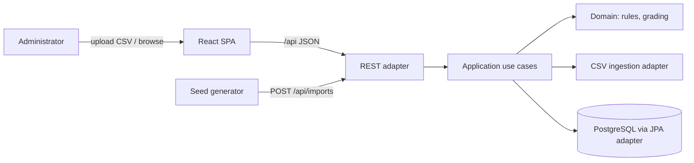
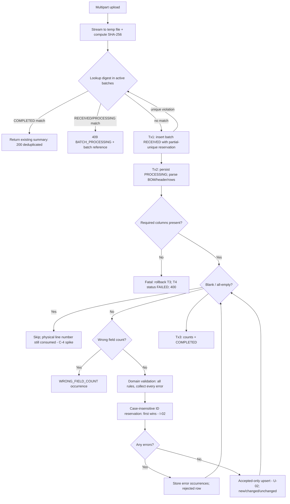
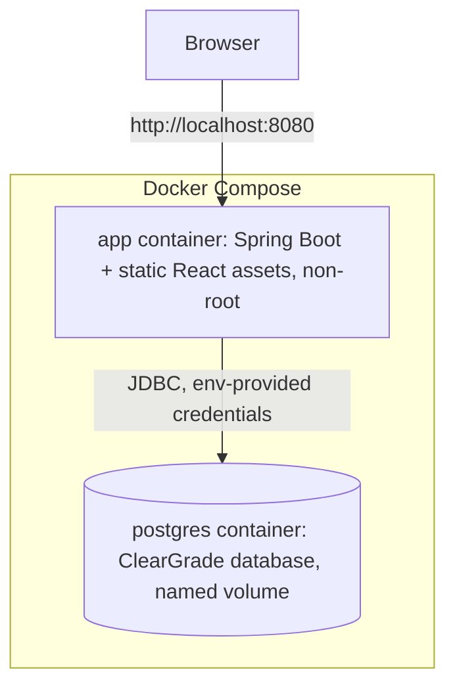
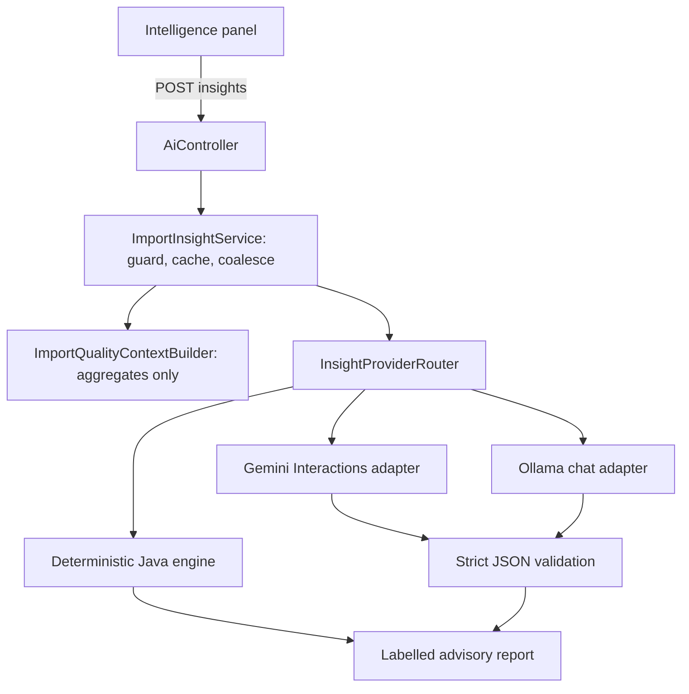

# ClearGrade — Architecture

Status: **Design documentation with the full delivery implemented.** Domain, V1 schema, JPA adapters, application ports/T1–T4 services, the production CSV adapter, the REST API, the React SPA and ClearGrade Intelligence are implemented. Conventions: `[REQ]` assignment/README requirement; `[REC]` engineering choice; `[INF]` data-confirmed inference; `[SPIKE]` resolved pre-implementation verification.

## 1. Context and system overview

An administrator receives term results as messy CSV exports and currently repairs them by hand. ClearGrade accepts an upload, makes valid rows available, explains rejected rows in plain language, and lets the administrator open an individual report. `[REQ]`

**Scope limitation — current-result snapshot.** The CSV has no academic term, school year or exam-period field. The portal stores **one current snapshot**; it cannot represent history, re-sits or multiple terms. History will not be invented (D-11). `[REC]`



In Docker Compose the SPA is served by nginx on the single published host port `8080`, which proxies same-origin `/api` and `/actuator/health` to the Spring Boot container; in native development Vite serves the SPA on `localhost:3000` and proxies `/api` to `localhost:8080`. Actuator management endpoints are **not** under `/api` (§7). `[REC]`

## 2. Component responsibilities

| Layer | Responsibility | Must NOT do |
|---|---|---|
| `domain` | Value objects, **pure** validation, grading policy, error-code vocabulary; `BigDecimal` marks | Import Spring, JPA, Commons CSV or any I/O |
| `application` | Use-case orchestration, inbound/outbound ports, transaction demarcation | Contain parsing logic or SQL |
| `adapters.in.web` | Controllers, DTO mapping, status codes, multipart handling | Contain business rules |
| `adapters.in.csv` | BOM/line-ending handling, header mapping, quoted fields, **physical line numbers (C-4 spike)** | Decide validity beyond structural shape |
| `adapters.out.persistence` | JPA entities, repositories, Flyway migrations | Expose entities beyond this adapter |
| `configuration` | Bean wiring, injected `Clock` (I-04), properties, CORS | Contain business logic |
| `frontend` | Four screens plus the intelligence panel, states, API client, typed models | Duplicate validation rules |

Dependencies point inward: `adapters → application → domain`. Domain depends on nothing (plain Java 21). Enforced by package discipline plus an architecture test (G2→G3). No Maven multi-module split initially (D-01, D-02). `[REC]`

**Frontend architecture `[REC]`:** React 19, **React Router** for `/import`, `/students`, `/student-report` and `/students/{studentId}`; **TanStack Query** for server state (caching, loading/error states, retry); **local component state** for form/dropzone/UI state. **No Redux.** `/student-report` is the Student Report Finder; `/students/{studentId}` is the individual student report.

## 3. Data flow



Row numbers must be **physical file line numbers, header = 1, blank lines counted** `[REQ]`; the C-4 spike (§9) is approved and its mechanism/limitations are carried into the production CSV adapter (§11).

## 4. Import lifecycle and identical-file idempotency (C-1, C-2)

```mermaid
stateDiagram-v2
    [*] --> RECEIVED: Tx1 reserved batch via partial unique index
    RECEIVED --> PROCESSING: Tx2 persists status explicitly
    PROCESSING --> COMPLETED: Tx3 writes counts + status
    PROCESSING --> FAILED: fatal error; T4 marks FAILED after T3 rollback
    RECEIVED --> FAILED: crash/recovery sweep timeout
    COMPLETED --> [*]
    FAILED --> [*]
```



**Database-enforced reservation.** A PostgreSQL **partial unique index** on `import_batch(sha256)` covering `status IN ('RECEIVED','PROCESSING','COMPLETED')` guarantees two concurrent requests cannot both reserve active content. Failed batches are excluded, so retry is permitted. Exact DDL and conflict handling are specified in DATA_MODEL.md §5–7.

| Situation | Response |
|---|---|
| Identical **COMPLETED** upload | Existing batch summary, `200`, `deduplicated: true`; **no new batch row** |
| Identical **RECEIVED / PROCESSING** upload | `409` `BATCH_PROCESSING` with `batchId` (documented conflict) |
| Identical **FAILED** upload | New batch row created; retry allowed; failed record retained |
| Concurrent identical uploads | One wins the unique reservation; the loser catches the uniqueness violation, re-reads and returns the matching case above |
| Stale RECEIVED/PROCESSING after crash | Startup/retry sweep marks timed-out batch `FAILED` (configurable), freeing the digest for retry |

A row-level error never moves the batch to `FAILED` `[REQ]`. Successful row validation must never silently round marks (§8).

## 5. Failure handling

| Failure | Behaviour |
|---|---|
| Missing required column | File-level `400` listing missing columns; batch `FAILED`; no students written |
| BOM, CRLF/LF, quoted commas/values, Unicode, extra/reordered headers | Normalised by CSV adapter; not errors `[REQ, U-04]` |
| Wrong field count | One `WRONG_FIELD_COUNT` occurrence; row rejected; rest of file continues `[I-01]` |
| Invalid/missing field | Every applicable occurrence collected; only **accepted** rows can change data `[U-02]` |
| Duplicate ID | `DUPLICATE_ID` on later occurrences; first reserves even if rejected `[I-02]` |
| Non-UTF-8 decodable content | `400 INVALID_ENCODING`; batch `FAILED`; no student writes |
| Unexpected I/O or runtime exception | `500` with correlation id; batch `FAILED`; no partial student writes |
| Oversized upload | `413` before parsing; limit configurable, default 10 MiB `[U-06]` |
| Physical line number | C-4 spike evidence approved (§9); production CSV adapter must adopt the mechanism and its documented limitations before ingestion goes live |

## 6. Transaction strategy

Distinct transactional steps, using **separate transaction service beans or `TransactionTemplate`** for each requires-new step — **no `REQUIRES_NEW` self-invocation** inside one Spring bean. The numbering follows the owner resolution in DECISIONS.md (2026-11-20):

1. **Lookup (read-only, fresh transaction).** Decide dedup/conflict/retry before any write. On the exact active-digest `ux_import_batch_active_sha256` violation (SQLSTATE `23505`), re-read the digest after the failed reservation transaction has rolled back.
2. **T1 (`REQUIRES_NEW`).** Independently commit `import_batch` as `RECEIVED` with its digest.
3. **T2 (`REQUIRES_NEW`).** Independently commit the explicit `PROCESSING` transition.
4. **T3 (`REQUIRES_NEW`).** One atomic transaction for accepted student upserts, `import_row_error` occurrences, final counts and `COMPLETED`. Any failure rolls all of them back.
5. **T4 (`REQUIRES_NEW`).** Only after T3 has rolled back, independently commit `FAILED`; a FAILED batch has no student writes.

Single transaction for all rows is appropriate at ~5,000 rows; chunking would require explicit progress state. `[REC]`

## 7. Deployment architecture



- Multi-stage `Dockerfile`: Node build stage (React) + Maven build stage; small runtime JRE image containing both artifacts.
- **Port mapping: host `8080` → container `8080`** (`8080:8080`). PostgreSQL listens on container `5432` internally and is reachable container-to-container over the Compose network. For local development it is published on the **host loopback interface only** as `127.0.0.1:${POSTGRES_PORT}:5432`; it is never bound to LAN interfaces.
- Compose provides healthchecks, a named DB volume, resource limits and a non-root app user. No reverse proxy, message broker or cache (D-01).
- **Actuator:** only `/actuator/health` is exposed; all other management endpoints are disabled (SECURITY.md). It is a management path, **not** under `/api` (T-5).

## 8. Proposed source folder structure

```text
cleargrade/
  pom.xml                      # single Maven module
  Dockerfile
  docker-compose.yml
  README.md  DECISIONS.md  DEVELOPMENT.md  PROJECT_STATUS.md
  docs/
    ARCHITECTURE.md  DATA_MODEL.md  API_CONTRACT.md
    UX_SPEC.md  SECURITY.md  TEST_STRATEGY.md
  backend/
    config/                                  # EXTERNAL to Maven resources (D-20)
      application-local.example.properties    # placeholders only (committed)
      application-local.properties            # real local credentials (GIT-IGNORED, never packaged)
    src/
      main/java/dev/cleargrade/
        domain/                # pure Java (BigDecimal marks; NO framework imports)
        application/           # usecase, port.in, port.out, tx service beans
        adapters/in/web/       # controllers, dto, exception handler
        adapters/in/csv/       # parser, header mapper, physical-line strategy (C-4)
        adapters/out/persistence/ # entities, repositories, mappers
        configuration/         # Clock, CORS, properties
      main/resources/
        application.properties                  # shared non-secret defaults (committed)
        db/migration/                           # Flyway SQL (created in implementation phase)
      test/java/...              # mirrors main packages
  frontend/
    package.json  tsconfig.json  ...
    src/
      api/  pages/  components/  types/  styles/
```

**Configuration boundary (D-20):** only `application.properties` and Flyway migrations live under `src/main/resources`. Private local profile configuration lives in `backend/config/`, outside the classpath; Spring Boot discovers it via its default `file:./config/` location when run from `backend/`, and it is excluded from Git and the Docker build context. Docker uses environment variables from root `.env`; the `local` profile is never active in production.

**Seed script (T-1):** a top-level `scripts/` generator produces a realistic messy CSV and **submits it through `POST /api/imports`**, exercising the real upload, validation, dedup and persistence pipeline — never a direct DB write.

## 9. Open verification gate — physical line numbers (C-4)

**Status: spike evidence approved; G2→G3 passed by owner 2026-11-20; mechanism adopted in production (§11).** The merged PR #3 spike proves the approach against the chosen Commons CSV version; all documented limitations (`backend/src/test/resources/csv-spike/README.md`) are carried forward unchanged. CSV record numbers are **not** physical line numbers. The spike verified: (a) a quoted field containing an embedded newline; (b) blank physical lines; (c) a malformed row after the embedded newline; (d) a subsequent valid row. The reported source line is the **physical starting line** of the problematic record, with the header as line 1. A simple counting `Reader` is **not** acceptable without testing parser buffering/read-ahead. See TEST_STRATEGY.md §2 and DEVELOPMENT.md gate G2→G3.

## 10. Traceability to assignment requirements

| Assignment requirement | Design location |
|---|---|
| Four screens | UX_SPEC.md |
| Upload never crashes on bad data/files | §5, SECURITY.md |
| Explain rejections in administrator language | API_CONTRACT.md, UX_SPEC.md |
| Searchable, paginated directory | API_CONTRACT.md, DATA_MODEL.md |
| State grading scheme | DECISIONS.md D-07 |
| Seed script, tests, Docker, README, NOTES | DEVELOPMENT.md, README.md |
| Build for the unseen file | U-04, DATA_MODEL.md, TEST_STRATEGY.md |

`NOTES.md` is reserved for the final assignment submission (Phase 7); DECISIONS.md is its source of truth.

## 11. Production CSV adapter and import use case (implemented, G3→G4)

`adapters.in.csv.CommonsCsvFileParser` implements the application-owned `application.port.in.CsvFileParser` and returns only application-owned `ParsedCsv` types (no Commons CSV type escapes the adapter). `CsvRowValidator` (application) turns header-mapped rows into `ValidatedRows` using existing domain value objects; `ImportApplicationService` owns the full sequence: SHA-256 over the original bytes → T1 `RECEIVED` → T2 `PROCESSING` → parse and validate → T3 atomic upserts/errors/counts/`COMPLETED`, or T4 `FAILED` when parsing/validation/T3 fails. The adapter contains no SQL, business validation or transaction handling; the domain contains no framework or CSV imports; no JPA entity is exposed to the adapter or application.

Parsing behaviour (derived from `reference/README.md` and the C-4 spike fixtures, never from sample-specific constants):

- Explicit `CSVFormat` with comment markers disabled; UTF-8 decoded text with a leading BOM stripped **before** both the line map and parser are built.
- Header-based mapping: order-insensitive, case-insensitive, surrounding spaces ignored, uniqueness checked; data rows compared against the **actual parsed header width** (I-01), not a fixed constant.
- LF, CRLF, mixed endings, lone CR, quoted commas/newlines, supplementary Unicode and reordered/extra columns are preserved and mapped correctly.
- Blank and all-empty physical lines are counted for line accuracy but excluded from imported/rejected counters and error occurrences.
- Recoverable wrong-field-count rows produce one `WRONG_FIELD_COUNT` occurrence and parsing continues; unterminated quotes, empty files, header-only files and duplicate headers are safe file-level failures with a diagnosable retained cause and no raw CSV/PII in messages or logs.
- Each row's physical starting line uses `CSVRecord.getCharacterPosition()` plus the independent `PhysicalLineMap` (header = 1, blank lines counted) adopted from the C-4 spike.
- Duplicate IDs use the domain `StudentId` normalization: the first valid occurrence reserves the ID even when that row is rejected for other reasons; later occurrences get `DUPLICATE_ID` (I-02). Complete error lists yield one persisted `import_row_error` row per occurrence (D-10), each pinned to the physical starting line.

All six C-4 limitations remain carried forward: (1) unterminated quotes are file-level failures; (2) comment markers stay disabled; (3) `read(Path)`/byte input strips the BOM before mapping; (4) string-based callers must strip a BOM first; (5) offsets are UTF-16 code units built from the same decoded source; (6) field-count consistency is computed against the configured/parsed header, not `isConsistent()`.

## 12. ClearGrade Intelligence (post-release, implemented)

The optional analysis feature keeps the same inward dependency rule. `application.port.out.ImportInsightProvider`
is the outbound boundary; `application.service.InsightProviderRouter` owns provider order (Gemini → Ollama →
`DeterministicInsightService`) and failure categories; `ImportQualityContextBuilder` produces the single
privacy-safe aggregate DTO; `ImportInsightService` guards batch status, coalesces concurrent requests and owns a
bounded TTL/LRU cache. Provider HTTP code, prompt construction and response parsing live only in
`adapters.out.ai` (`gemini/`, `ollama/`), never in `application` or `domain`. No AI SDK, framework or agent
runtime is added; plain Java `HttpClient` is used.



The router never calls both cloud and local providers concurrently and never mutates import state. The
deterministic engine is always available unless explicitly disabled, so a no-key/no-Ollama install still
returns a labelled `RULE_BASED` report. Details: [AI_INTELLIGENCE.md](AI_INTELLIGENCE.md).
