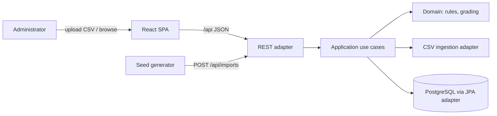
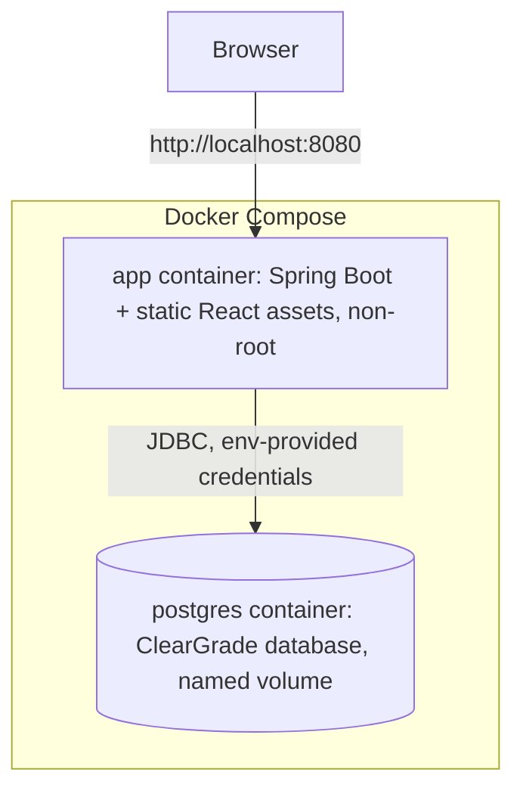

# ClearGrade — Architecture

Status: **Design documentation only — not implemented.** All statements are plans. Conventions: `[REQ]` assignment/README requirement; `[REC]` engineering choice; `[INF]` data-confirmed inference; `[SPIKE]` unresolved pre-implementation verification.

## 1. Context and system overview

An administrator receives term results as messy CSV exports and currently repairs them by hand. ClearGrade accepts an upload, makes valid rows available, explains rejected rows in plain language, and lets the administrator open an individual report. `[REQ]`

**Scope limitation — current-result snapshot.** The CSV has no academic term, school year or exam-period field. The portal stores **one current snapshot**; it cannot represent history, re-sits or multiple terms. History will not be invented (D-11). `[REC]`



The SPA is served as static assets by the same Spring Boot process (one origin, `localhost:8080`). Actuator management endpoints are **not** under `/api` (§7). `[REC]`

## 2. Component responsibilities

| Layer | Responsibility | Must NOT do |
|---|---|---|
| `domain` | Value objects, **pure** validation, grading policy, error-code vocabulary; `BigDecimal` marks | Import Spring, JPA, Commons CSV or any I/O |
| `application` | Use-case orchestration, inbound/outbound ports, transaction demarcation | Contain parsing logic or SQL |
| `adapters.in.web` | Controllers, DTO mapping, status codes, multipart handling | Contain business rules |
| `adapters.in.csv` | BOM/line-ending handling, header mapping, quoted fields, **physical line numbers (C-4 spike)** | Decide validity beyond structural shape |
| `adapters.out.persistence` | JPA entities, repositories, Flyway migrations | Expose entities beyond this adapter |
| `configuration` | Bean wiring, injected `Clock` (I-04), properties, CORS | Contain business logic |
| `frontend` | Three screens, states, API client, typed models | Duplicate validation rules |

Dependencies point inward: `adapters → application → domain`. Domain depends on nothing (plain Java 21). Enforced by package discipline plus an architecture test (G2→G3). No Maven multi-module split initially (D-01, D-02). `[REC]`

**Frontend architecture `[REC]`:** React 18+, **React Router** for `/import`, `/students`, `/students/:id`; **TanStack Query** for server state (caching, loading/error states, retry); **local component state** for form/dropzone/UI state. **No Redux** unless a justified need appears. TanStack Query is a planned dependency, not installed in this phase.

## 3. Data flow


Row numbers must be **physical file line numbers, header = 1, blank lines counted** `[REQ]`; the mechanism is the open C-4 spike (§9).

## 4. Import lifecycle and identical-file idempotency (C-1, C-2)

```mermaid
stateDiagram-v2
    [*] --> RECEIVED: Tx1 reserved batch via partial unique index
    RECEIVED --> PROCESSING: Tx2 persists status explicitly
    PROCESSING --> COMPLETED: Tx3 writes counts + status
    PROCESSING --> FAILED: fatal error; Tx3 marks FAILED
    RECEIVED --> FAILED: crash/recovery sweep timeout
    COMPLETED --> [*]
    FAILED --> [*]
```



**Database-enforced reservation.** A PostgreSQL **partial unique index** on `import_batch(sha256)` covering `status IN ('RECEIVED','PROCESSING','COMPLETED')` guarantees two concurrent requests cannot both reserve active content. Failed batches are excluded, so retry is permitted. Exact DDL and conflict handling are specified in DATA_MODEL.md §5–7.

| Situation | Response |
|---|---|
| Identical **COMPLETED** upload | Existing batch summary, `200`, `deduplicated: true`; **no new batch row** |
| Identical **RECEIVED / PROCESSING** upload | `409` `BATCH_PROCESSING` with `batchId` (documented conflict) |
| Identical **FAILED** upload | New batch row created; retry allowed; failed record retained |
| Concurrent identical uploads | One wins the unique reservation; the loser catches the uniqueness violation, re-reads and returns the matching case above |
| Stale RECEIVED/PROCESSING after crash | Startup/retry sweep marks timed-out batch `FAILED` (configurable), freeing the digest for retry |

A row-level error never moves the batch to `FAILED` `[REQ]`. Successful row validation must never silently round marks (§8).

## 5. Failure handling

| Failure | Behaviour |
|---|---|
| Missing required column | File-level `400` listing missing columns; batch `FAILED`; no students written |
| BOM, CRLF/LF, quoted commas/values, Unicode, extra/reordered headers | Normalised by CSV adapter; not errors `[REQ, U-04]` |
| Wrong field count | One `WRONG_FIELD_COUNT` occurrence; row rejected; rest of file continues `[I-01]` |
| Invalid/missing field | Every applicable occurrence collected; only **accepted** rows can change data `[U-02]` |
| Duplicate ID | `DUPLICATE_ID` on later occurrences; first reserves even if rejected `[I-02]` |
| Non-UTF-8 decodable content | `400 INVALID_ENCODING`; batch `FAILED`; no student writes |
| Unexpected I/O or runtime exception | `500` with correlation id; batch `FAILED`; no partial student writes |
| Oversized upload | `413` before parsing; limit configurable, default 10 MiB `[U-06]` |
| Physical line number unverified | Ingestion must not go live until C-4 spike passes (§9) |

## 6. Transaction strategy

Four distinct transactional steps, using **separate transaction service beans or `TransactionTemplate`** for each requires-new step — **no `REQUIRES_NEW` self-invocation** inside one Spring bean:

1. **Lookup (read-only).** Digest query; decide dedup/conflict/retry before any write.
2. **Tx1 (`REQUIRES_NEW`).** Insert `import_batch` as `RECEIVED` inside a savepoint-style conflict handler; catch unique violation (SQLSTATE `23505`) and return existing batch state.
3. **Tx2 (single transaction).** Persist `status = PROCESSING` explicitly, stream rows, upsert accepted students and insert all error occurrences. Any fatal error rolls Tx2 back completely.
4. **Tx3 (`REQUIRES_NEW`).** Finalise `counts + status = COMPLETED`, or `status = FAILED` on fatal error. FAILED survives Tx2 rollback; a FAILED batch has no student writes.

Single transaction for all rows is appropriate at ~5,000 rows; chunking would require explicit progress state. `[REC]`

## 7. Deployment architecture



- Multi-stage `Dockerfile`: Node build stage (React) + Maven build stage; small runtime JRE image containing both artifacts.
- **Port mapping: host `8080` → container `8080`** (`8080:8080`). PostgreSQL listens on container `5432` internally and is **not published** to the host by default.
- Compose provides healthchecks, a named DB volume, resource limits and a non-root app user. No reverse proxy, message broker or cache (D-01).
- **Actuator:** only `/actuator/health` is exposed; all other management endpoints are disabled (SECURITY.md). It is a management path, **not** under `/api` (T-5).

## 8. Proposed source folder structure

```text
cleargrade/
  pom.xml                      # single Maven module
  Dockerfile
  docker-compose.yml
  README.md  DECISIONS.md  DEVELOPMENT.md  PROJECT_STATUS.md
  docs/
    ARCHITECTURE.md  DATA_MODEL.md  API_CONTRACT.md
    UX_SPEC.md  SECURITY.md  TEST_STRATEGY.md
  backend/
    config/                                  # EXTERNAL to Maven resources (D-20)
      application-local.example.properties    # placeholders only (committed)
      application-local.properties            # real local credentials (GIT-IGNORED, never packaged)
    src/
      main/java/dev/cleargrade/
        domain/                # pure Java (BigDecimal marks; NO framework imports)
        application/           # usecase, port.in, port.out, tx service beans
        adapters/in/web/       # controllers, dto, exception handler
        adapters/in/csv/       # parser, header mapper, physical-line strategy (C-4)
        adapters/out/persistence/ # entities, repositories, mappers
        configuration/         # Clock, CORS, properties
      main/resources/
        application.properties                  # shared non-secret defaults (committed)
        db/migration/                           # Flyway SQL (created in implementation phase)
      test/java/...              # mirrors main packages
  frontend/
    package.json  tsconfig.json  ...
    src/
      api/  pages/  components/  types/  styles/
```

**Configuration boundary (D-20):** only `application.properties` and Flyway migrations live under `src/main/resources`. Private local profile configuration lives in `backend/config/`, outside the classpath; Spring Boot discovers it via its default `file:./config/` location when run from `backend/`, and it is excluded from Git and the Docker build context. Docker uses environment variables from root `.env`; the `local` profile is never active in production.

**Seed script (T-1):** a top-level `scripts/` generator produces a realistic messy CSV and **submits it through `POST /api/imports`**, exercising the real upload, validation, dedup and persistence pipeline — never a direct DB write.

## 9. Open verification gate — physical line numbers (C-4)

**Status: UNRESOLVED pre-implementation spike. No solution is claimed here.** CSV record numbers are **not** physical line numbers. Before production ingestion the chosen Commons CSV version must be tested with: (a) a quoted field containing an embedded newline; (b) blank physical lines; (c) a malformed row after the embedded newline; (d) a subsequent valid row. The reported source line must be the **physical starting line** of the problematic record, with the header as line 1. A simple counting `Reader` is **not** acceptable without testing parser buffering/read-ahead. If the spike cannot prove the approach, the line-number feature must be redesigned before phase 3 is complete. See TEST_STRATEGY.md §2 and DEVELOPMENT.md gate G2→G3.

## 10. Traceability to assignment requirements

| Assignment requirement | Design location |
|---|---|
| Three screens | UX_SPEC.md |
| Upload never crashes on bad data/files | §5, SECURITY.md |
| Explain rejections in administrator language | API_CONTRACT.md, UX_SPEC.md |
| Searchable, paginated directory | API_CONTRACT.md, DATA_MODEL.md |
| State grading scheme | DECISIONS.md D-07 |
| Seed script, tests, Docker, README, NOTES | DEVELOPMENT.md, README.md |
| Build for the unseen file | U-04, DATA_MODEL.md, TEST_STRATEGY.md |

`NOTES.md` is reserved for the final assignment submission (Phase 7); DECISIONS.md is its source of truth.
