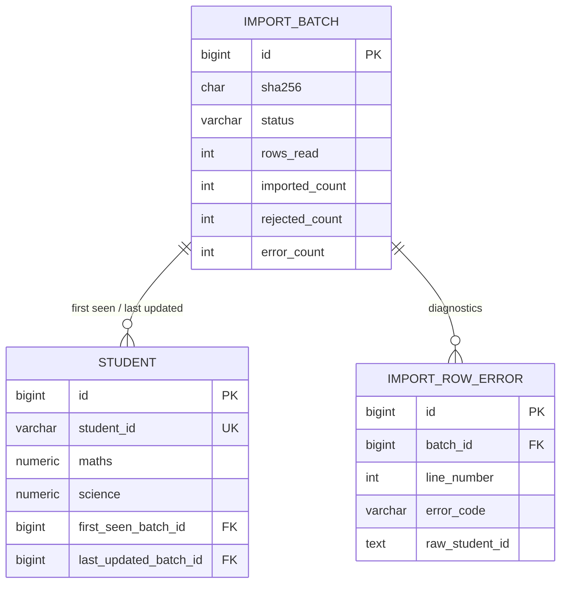

# ClearGrade — Data Model

Status: **Pure domain rules implemented (Phase 3B.1); V1 schema migration implemented and tested (Phase 3B.2.1), but no JPA entities or persistence services exist yet.** Decision IDs follow DECISIONS.md (superseded IDs are listed there).

## 1. Entity definitions

Three entities only. No term/year entity: the source format has none, so this is a current-result snapshot (D-11).

### `import_batch`
One row per accepted upload; anchor for traceability, identical-file reservation and diagnostics.

| Column | Type | Notes |
|---|---|---|
| `id` | `BIGSERIAL` | PK |
| `filename` | `VARCHAR(255)` | Client-supplied, sanitised for display only (SECURITY.md) |
| `file_size_bytes` | `BIGINT` | Upload size |
| `sha256` | `CHAR(64)` | Hex digest; covered by partial unique index (§3, §5) |
| `status` | `VARCHAR(16)` | `RECEIVED / PROCESSING / COMPLETED / FAILED` |
| `started_at`, `finished_at` | `TIMESTAMPTZ` | Timing |
| `duration_ms` | `BIGINT` | Processing duration |
| `rows_read` | `INTEGER` | Non-skipped data rows only |
| `imported_count` | `INTEGER` | `new_count + changed_count + unchanged_count` |
| `new_count`, `changed_count`, `unchanged_count` | `INTEGER` | Accepted-row outcome split (U-02) |
| `rejected_count` | `INTEGER` | **Rows** rejected (D-10) |
| `error_count` | `INTEGER` | Error **occurrences**; may exceed `rejected_count` (D-10) |

### `student`
One row per accepted student identity; re-imports update it.

| Column | Type | Notes |
|---|---|---|
| `id` | `BIGSERIAL` | PK |
| `student_id` | `VARCHAR(20)` | **Unique**, stored UPPERCASE; upsert key; CHECK constraint (§3) |
| `full_name` | `VARCHAR(100)` | Trimmed, internal whitespace collapsed |
| `email` | `VARCHAR(320)` | Stored lowercase; U-01 rule |
| `date_of_birth` | `DATE` | Validated against injected `Clock` (I-04); inclusive 5–25 (I-03); a 29 Feb birth increases age on 1 Mar in non-leap years (D-22) |
| `grade_level` | `SMALLINT` | 1–12 (`09` stored as `9`) |
| `section` | `CHAR(1)` | A–F, uppercase |
| `maths`, `science`, `english`, `social_studies`, `second_language` | **`NUMERIC`** | **No fixed scale** (C-3); domain uses `BigDecimal`, range 0–100, no silent rounding |
| `first_seen_batch_id` | `BIGINT` | FK → `import_batch.id`; **preserved on update** (U-02) |
| `last_updated_batch_id` | `BIGINT` | FK → `import_batch.id`; **updated on accepted change** (U-02) |
| `created_at`, `updated_at` | `TIMESTAMPTZ` | Audit |

Derived total/percentage/grade/pass are **not stored**; computed on read by the domain grading policy (D-07). Display percentage is rounded to one decimal (HALF_UP); **stored marks are never rounded** (C-3). `NUMERIC` without precision/scale preserves submitted decimal precision: the domain enforces only the inclusive range 0–100 and imposes **no arbitrary fractional-digit limit**.

### `import_row_error`
One row **per validation error occurrence**, not per rejected row (D-10).

| Column | Type | Notes |
|---|---|---|
| `id` | `BIGSERIAL` | PK |
| `batch_id` | `BIGINT` | FK → `import_batch.id`, indexed |
| `line_number` | `INTEGER` | Physical file line; header = 1, blank lines counted — **C-4 spike unresolved** |
| `raw_student_id` | **`TEXT`** | Raw ID as supplied; `TEXT` avoids silent truncation of pathological values |
| `field_name` | `VARCHAR(32)` | Canonical column name or `(whole row)` |
| `error_code` | `VARCHAR(24)` | `MISSING_REQUIRED / INVALID_FORMAT / OUT_OF_RANGE / DUPLICATE_ID / WRONG_FIELD_COUNT` `[REQ]` |
| `message` | `TEXT` | Administrator-friendly explanation; may contain an invalid raw value, never logged (SECURITY.md) |

## 2. Relationships



Two optional FKs from `student` to `import_batch`; no cascade. `import_row_error` many-to-one to batch; no purge planned.

## 3. Constraints and indexes (C-1, C-2)

- `student_id` non-null and unique on the stored uppercase value. **DB CHECK** on normalized format `[A-Z0-9-]{3,20}` (consistent with domain; defence in depth for the unseen file).
- `CHECK (grade_level BETWEEN 1 AND 12)`, `CHECK (section IN ('A'..'F'))`, `CHECK` each mark `BETWEEN 0 AND 100` (no scale restriction — C-3).
- `error_code CHECK` against the five allowed codes.
- **Final counts are exclusive to `COMPLETED`:** `rows_read`, `imported_count`, `new_count`, `changed_count`, `unchanged_count`, `rejected_count` and `error_count` must all be NULL for `RECEIVED`, `PROCESSING` and `FAILED`. `duration_ms` is independent and may be set outside finalisation.
- **Partial unique index (created in `V1__create_core_schema.sql`):**
  `CREATE UNIQUE INDEX ux_import_batch_active_sha256 ON import_batch (sha256) WHERE status IN ('RECEIVED','PROCESSING','COMPLETED');`
  Failed batches are excluded → retry permitted. This is the database-enforced guarantee that concurrent identical uploads cannot both import.

| Table | Index | Purpose |
|---|---|---|
| `student` | unique (`student_id`) | Upsert key + exact search |
| `student` | (`lower(full_name)`) | Case-insensitive name search |
| `student` | (`grade_level`, `section`) | Optional directory filters |
| `student` | (`first_seen_batch_id`), (`last_updated_batch_id`) | Traceability lookups |
| `import_row_error` | (`batch_id`, `line_number`) | Paged error display in file order |
| `import_row_error` | (`batch_id`, `error_code`) | Problems-by-code diagnostics |
| `import_batch` | **partial unique** (`sha256`) WHERE active | Identical-file reservation (C-2) |

Trigram index on `lower(full_name)` is deferred to performance verification, not assumed.

## 4. Duplicate, upsert and change semantics (I-02, U-02)

1. **Within one file `[INF, I-02]`:** first case-insensitive occurrence reserves the ID even if that row is rejected for other reasons; later occurrences get `DUPLICATE_ID`.
2. **Across files `[U-02]`:** upsert by uppercase `student_id`. **Only accepted rows** may change a stored student. A later row for an existing ID that is rejected must not modify the record. Preserve `first_seen_batch_id`; set `last_updated_batch_id` on an accepted change.
3. **Change detection:** compare normalized field values to decide `changed_count` vs `unchanged_count`. An accepted but identical row is `unchanged` (no update to marks/details; `last_updated_batch_id` not advanced for unchanged rows).
4. **Identical file `[D-09/C-1/C-2]`:** digest lookup returns an existing `COMPLETED` summary (`200`, no new batch); an active batch returns `409 BATCH_PROCESSING`; a `FAILED` batch permits retry with a new batch row.
5. No student is ever deleted by an import.

## 5. Identical-file reservation sequence (C-1, C-2)

```mermaid
sequenceDiagram
    participant API as REST adapter
    participant App as Application service
    participant DB as Persistence adapter
    API->>App: upload(file)
    App->>App: compute SHA-256 from streamed temp file
    App->>DB: read-only lookup by sha256
    alt COMPLETED match
        App-->>API: 200 existing summary + deduplicated=true (no insert)
    else RECEIVED/PROCESSING match
        App-->>API: 409 BATCH_PROCESSING + batchId
    else no match or FAILED only
        App->>DB: Tx1 REQUIRES_NEW insert batch RECEIVED
        alt unique violation (23505)
            App->>DB: re-read digest; return completed/processing case above
        else inserted
            App->>DB: Tx2 persist PROCESSING; upsert + errors
            alt fatal file error
                App->>DB: Tx3 REQUIRES_NEW status FAILED
            else success
                App->>DB: Tx3 REQUIRES_NEW counts + COMPLETED
            end
            App-->>API: 201 summary
        end
    end
```

Stale `RECEIVED`/`PROCESSING` batches (crash) are marked `FAILED` by a startup/retry sweep after a configurable timeout, excluding them from the partial index and freeing the digest for retry.

## 6. Batch lifecycle storage rules

Batch row exists before parsing so fatal errors can be recorded. `PROCESSING` is **explicitly persisted** at the start of Tx2 (not inferred). Counts are written only at finalisation. Error occurrences are written during Tx2 and roll back with it. A `FAILED` batch has no student writes and is retained for diagnostics.

## 7. Transaction boundaries

`REQUIRES_NEW` work is performed by **separate transaction service beans or `TransactionTemplate`** — never by self-invocation within one Spring bean, which would silently run in the caller's transaction. Tx1 reserves the digest, Tx2 is the single all-or-nothing data transaction, Tx3 durably finalises `COMPLETED` or `FAILED`. Chunking is deferred; it would require explicit progress state.

## 8. Physical line numbers (C-4)

`line_number` semantics are specified but the **implementation mechanism is an unresolved pre-implementation spike**. No solution is claimed. Must be proven against the chosen Commons CSV version before ingestion goes live (ARCHITECTURE.md §9, TEST_STRATEGY.md §2).

## 9. Traceability

Every accepted student records the batch that introduced it and, on accepted change, the batch that last changed it; every rejected row has one or more `import_row_error` rows linked to batch and physical line. This supports the assignment's requirement to explain what happened to each row. `[REQ]`
